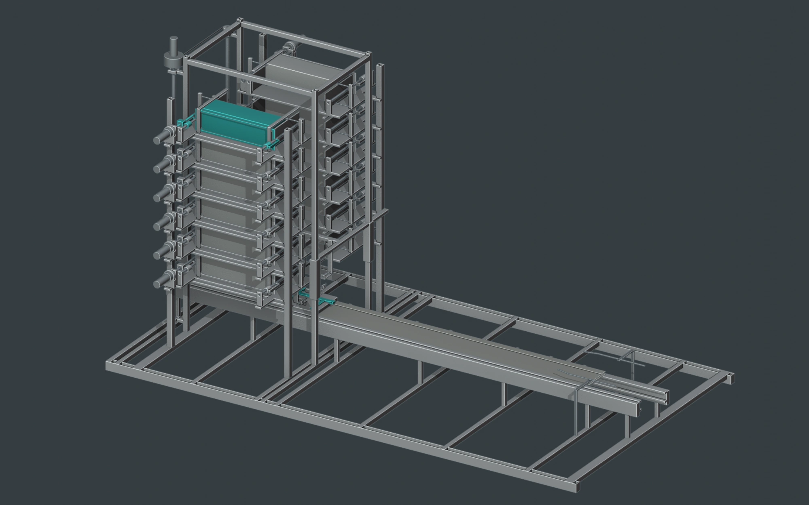

# VOLLEY — Engineering Thesis
### Design and Computational Evaluation of a Commanded Electromagnetic CubeSat Deployment Mechanism

**Adityavardhan Mishra and Pratham Chawla** 
Mechanical Engineering · Symbiosis Institute of Technology, Pune

VOLLEY is a commanded CubeSat deployment mechanism combining individually restrained storage, guided feed, a captive transfer pallet and a reusable electromagnetic launch carrier. This repository presents the **completed Gen5 ACR1 computational design study**, its report and presentation, and the local engineering record supporting its conclusions.

**[Read the report · 58 pages](editions/ED3/VOLLEY_ED3_Report.pdf)** · **[View the presentation · 17 slides](editions/ED3/VOLLEY_ED3_Presentation.pdf)** · [Document sources](editions/ED3/README.md) · [Local CAD and analyses](current/README.md)

*CAD-derived Blender render · Gen5 ACR1 home state. [Geometry and render provenance](figures/acr1-polish/POLISH_PROVENANCE.json).*

## Study at a glance

| Parameter | Evaluated reference |
|:--|:--|
| Payloads | Twelve 4 kg 3U envelope surrogates |
| Commanded release cases | **1, 2 and 3 m/s** |
| Powered travel | **1.300 m** |
| Mechanism | Fixed banks → guided lead-screw feed → indexed lift → captive pallet → retained magnetic carrier |
| Represented dry mass | **149.557 kg**, plus a separate **7 kg** power/control allowance |
| Host and mission | Generic manoeuvring host; nominal 500 km SSO; common position/velocity target epoch |

## The deployment cycle

The selected cell transfers its payload to the lift. Receiving locks capture the pallet before the lift withdraws. The motor accelerates the loaded carrier; passive release cams open the payload restraint, and active braking arrests the retained carrier and pallet for recovery.

*Four operating states from the represented CAD. [Handoff close-up](figures/acr1-polish/feeder_detail_annotated.png) · [Motion checks](current/cad/release/MOTION_VERIFICATION.json) · [Executable custody specification](current/analysis/TRANSFER_INTERLOCKS.json).*

## Results and engineering contribution

The study connects mechanical custody, finite electromagnetic force, electrical source limits, payload departure, retained-carrier arrest and host-level mission resources within one configuration.

| Area | Completed computational result |
|:--|:--|
| Geometry and motion | Eight native/STEP assembly states and 154 accepted sampled motion/refinement cases |
| Control logic | 24 accepted nominal commands and 166 declared logic tests |
| Launch and arrest | Nominal/adverse source-coupled cases; principal 3 m/s cases checked at 20 and 5 µs timesteps |
| Structural analysis | Matched-load ANSYS/CalculiX bare-chassis comparison, with 0.143% primary peak-displacement difference and three ANSYS mesh levels |
| Mission evaluation | Same-target twelve-release campaigns and native Orekit numerical replays, including full installed mass and recoil |

The mission trade establishes where the concept must earn its installed burden: the tested preplanned campaigns show no propellant or initial wet-mass advantage over ideal ground-pretrimmed springs. The report presents this result alongside the demonstrated numerical behaviour of the selected mechanism. Physical prototype correlation and qualification form the subsequent development programme.

## Report, presentation and supporting record

| Material | Location |
|:--|:--|
| Latest report and presentation | [Academic edition ED3](editions/ED3/README.md) |
| Portable report/presentation builders and figures | [ED3 source archive](editions/ED3/VOLLEY_ED3_Document_Sources.zip) |
| Native CAD, STEP and BOM | [All eight assembly states](current/cad/release/) |
| Analysis methods and captured results | [Results](current/RESULTS.md) · [Chapter/figure map](current/ACADEMIC_MAP.md) |
| Source and selected numerical reproduction | [Build and run guide](current/REPRODUCE.md) |
| Matched structural solver inputs | [ANSYS static source archive](editions/ED2/ACR1_ANSYS_Static_Sources.zip) |
| Original report/manuscript capture | [ED1 academic files](current/academic/README.md) · [Dated original](archive/2026-10-24-acr1-original/README.md) |

This checkout contains its supporting engineering core, eight CAD/STEP states and the indexed raw solver supplement. It can be inspected and its selected examples run independently. ED3 is the current report/presentation edition; the separately identified nine-page manuscript retains its ED1 source and results.

[Scientific figure conventions](docs/FIGURE_STANDARD.md) · [Capture verification](VALIDATION_CURRENT.json) · [Citation](CITATION.cff) · [Licensing](LICENSING.md) · [Edition and errata policy](RELEASE_POLICY.md)
