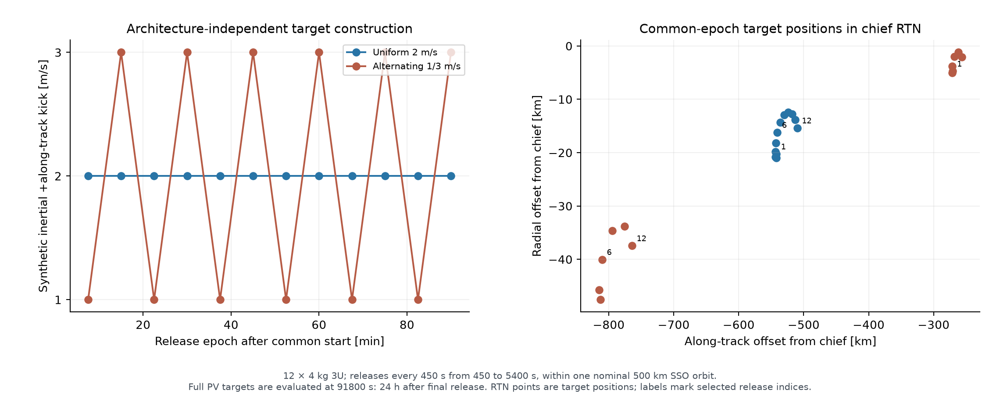

# VOLLEY — Engineering Thesis
### Design and Computational Evaluation of a Commanded Electromagnetic CubeSat Deployment Mechanism

**Adityavardhan Mishra and Pratham Chawla** 
Mechanical Engineering · Symbiosis Institute of Technology, Pune

VOLLEY is a commanded CubeSat deployment mechanism combining individually restrained storage, guided feed, a captive transfer pallet and a reusable electromagnetic launch carrier. This repository presents the **completed computational design study**, its report and presentation, and the local engineering record supporting its conclusions.

**[Read the report · 58 pages](editions/ED3/VOLLEY_ED3_Report.pdf)** · **[View the presentation · 17 slides](editions/ED3/VOLLEY_ED3_Presentation.pdf)** · [Document sources](editions/ED3/README.md) · [Local CAD and analyses](current/README.md)

*CAD-derived Blender render · Evaluated mechanism in its home position. [Geometry and render provenance](figures/acr1-polish/POLISH_PROVENANCE.json).*

## Study at a glance

| Parameter | Evaluated reference |
|:--|:--|
| Payloads | Twelve 4 kg 3U envelope surrogates |
| Commanded release cases | **1, 2 and 3 m/s** |
| Powered travel | **1.300 m** |
| Mechanism | Fixed banks → guided lead-screw feed → indexed lift → captive pallet → retained magnetic carrier |
| Represented dry mass | **149.557 kg**, plus a separate **7 kg** power/control allowance |
| Host and mission | Generic manoeuvring host; nominal 500 km SSO; common position/velocity target epoch |

## The deployment cycle

The selected cell transfers its payload to the lift. Receiving locks capture the pallet before the lift withdraws. The motor accelerates the loaded carrier; passive release cams open the payload restraint, and active braking arrests the retained carrier and pallet for recovery.

*Four operating states from the represented CAD. [Handoff close-up](figures/acr1-polish/feeder_detail_annotated.png) · [Motion checks](current/cad/release/MOTION_VERIFICATION.json) · [Executable custody specification](current/analysis/TRANSFER_INTERLOCKS.json).*

## Results and engineering contribution

The study follows the full deployment cycle. Geometry defines the payload path and moving mass. The finite motor and electrical source determine the launch and arrest. The mission comparison then accounts for the retained mechanism and the host manoeuvres.

| Area | Completed computational result |
|:--|:--|
| Geometry and motion | Eight native/STEP assembly states and 154 accepted sampled motion/refinement cases |
| Control logic | 24 accepted nominal commands and 166 declared logic tests |
| Launch and arrest | Nominal/adverse source-coupled cases; principal 3 m/s cases checked at 20 and 5 µs timesteps |
| Structural analysis | Matched-load ANSYS/CalculiX bare-chassis comparison, with 0.143% primary peak-displacement difference and three ANSYS mesh levels |
| Mission evaluation | Same-target twelve-release campaigns and native Orekit numerical replays, including full installed mass and recoil |

The mission trade establishes where the concept must earn its installed burden: the tested preplanned campaigns show no propellant or initial wet-mass advantage over ideal ground-pretrimmed springs. The report presents this result alongside the demonstrated numerical behaviour of the selected mechanism. Physical prototype correlation and qualification form the subsequent development programme.

### From magnetic geometry to release dynamics

The finite motor calculation retains the stator's spatial extent and represented return conductors. Its force-position map feeds the electrical and mechanical model, linking the CAD reference to the predicted departure condition.

*Computed electromagnetic result. [Finite motor calculation](current/analysis/FINITE_MOTOR.json) · [Actual-conductor-current comparison](current/analysis/CURRENT_FIELD_FORCE.json). Numerical formulations retain their stated shared assumptions.*

*Computed result · nominal 3 m/s case. [Captured cases](current/analysis/COUPLED_SHOT.json) and [numerical refinement audit](current/verification/COUPLED_SHOT_REVIEW.json) connect launch, payload departure and retained-carrier arrest.*

### Structure and mission consequences

Structural and orbital calculations carry the mechanism beyond a motor-only result. The chassis study applies the stated loading and restraint boundary; the mission study counts retained device mass, host manoeuvres and recoil against shared delivery targets.

*Computed structural result · the represented chassis and declared numerical supports. [Structural review](current/verification/CHASSIS_ACTUAL_REVIEW.md). This is solver output for the stated model, rather than a photograph of a test.*

*Computed mission geometry · synthetic common-epoch target families. [Target definition](current/mission/MISSION_INPUTS.json) · [Resource results](current/mission/MISSION_RESULTS.csv) · [Native Orekit replay](current/mission/NATIVE_REPLAY_CHECKS.json). The same delivered states define the comparison.*

## Design development

The local [development archive](archive/README.md) preserves the earlier design studies, reports and numerical investigations leading to the integrated Gen5 reference. The current documents explain the selected mechanism and its evaluation; Gen6 development is presented as the subsequent research and prototype programme. [Repository map](docs/REPOSITORY_MAP.md).

The next development stage is an instrumented prototype. Component tests will first measure transfer forces, lock sequencing and motor force. The integrated prototype will then demonstrate mixed 1U/3U release, carrier arrest and return. Host-specific qualification and a later flight demonstrator follow the measured prototype results.

## Report, presentation and supporting record

| Material | Location |
|:--|:--|
| Latest report and presentation | [Blackbook report and presentation](editions/ED3/README.md) |
| Portable report/presentation builders and figures | [Report and presentation source archive](editions/ED3/VOLLEY_ED3_Document_Sources.zip) |
| Native CAD, STEP and BOM | [All eight assembly states](current/cad/release/) |
| Analysis methods and captured results | [Results](current/RESULTS.md) · [Chapter/figure map](current/ACADEMIC_MAP.md) |
| Source and selected numerical reproduction | [Build and run guide](current/REPRODUCE.md) |
| Matched structural solver inputs | [ANSYS static source archive](editions/ED2/ACR1_ANSYS_Static_Sources.zip) |
| Original report/manuscript capture | [Original academic files](current/academic/README.md) · [Dated original](archive/2026-10-24-acr1-original/README.md) |

This checkout contains its supporting engineering core, eight CAD/STEP states and the indexed raw solver supplement. It can be inspected and its selected examples run independently. The report and presentation have their own source package. The separately archived nine-page manuscript retains its original source and results.

[Scientific figure conventions](docs/FIGURE_STANDARD.md) · [Capture verification](VALIDATION_CURRENT.json) · [Citation](CITATION.cff) · [Licensing](LICENSING.md) · [Edition and errata policy](RELEASE_POLICY.md)
