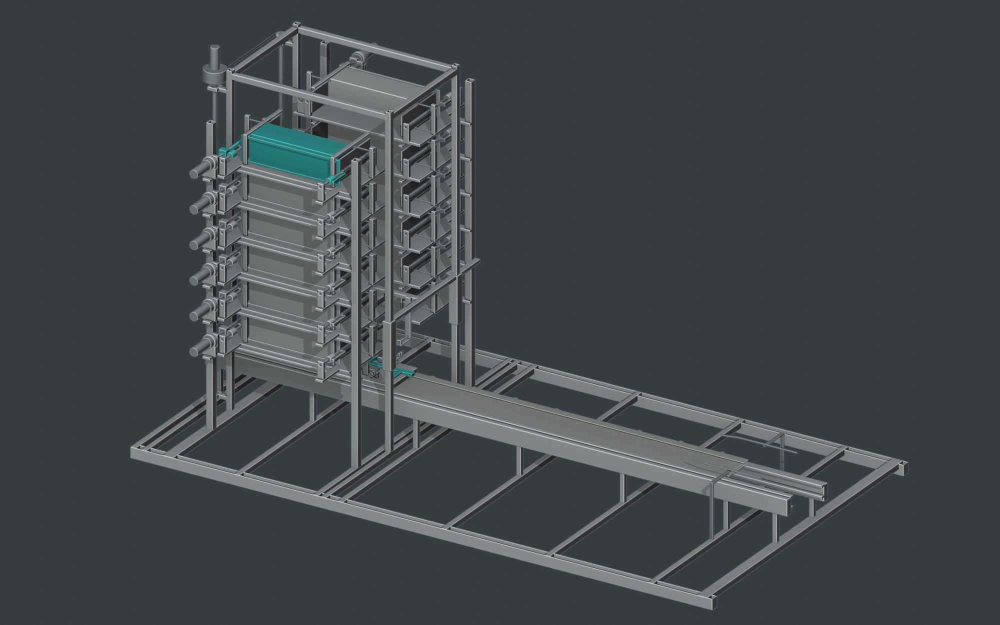
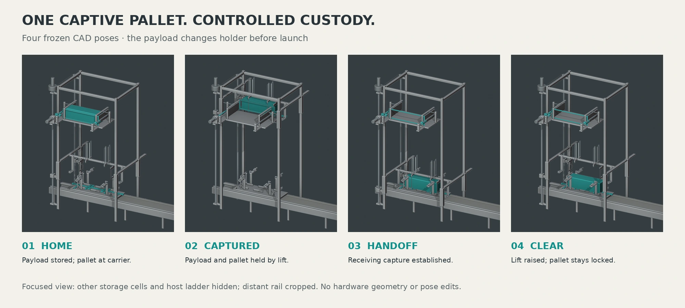
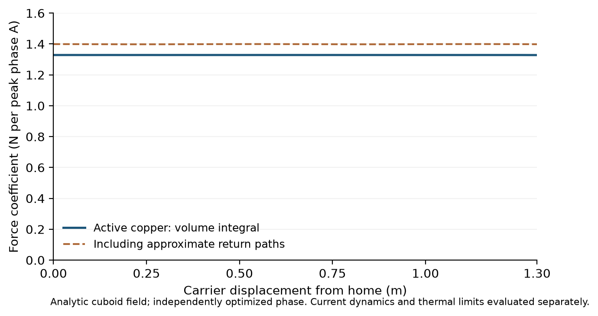
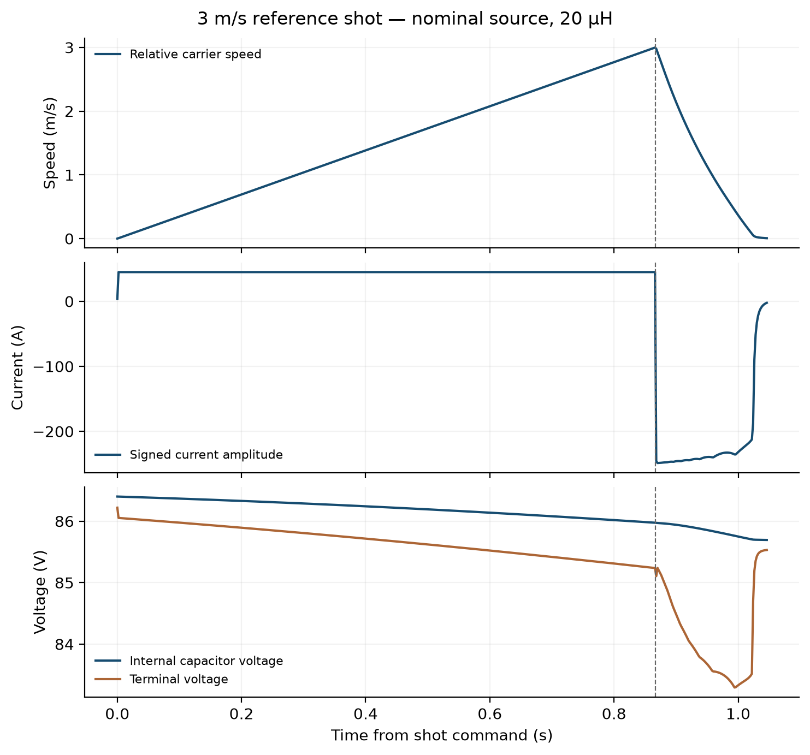
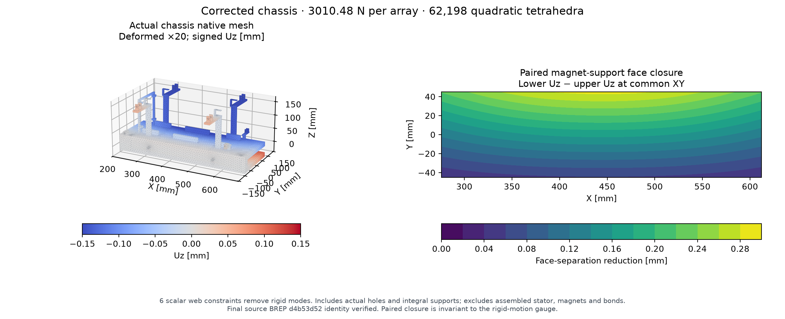
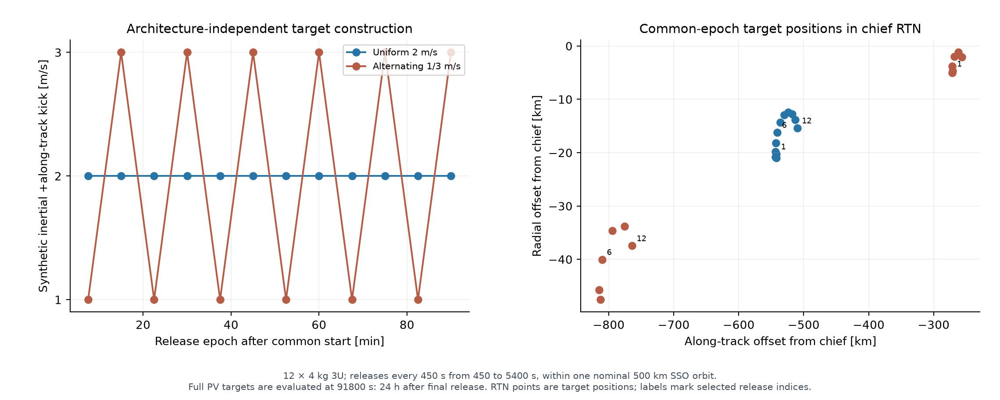

# VOLLEY — Engineering Thesis
### Design and Computational Evaluation of a Commanded Electromagnetic CubeSat Deployment Mechanism

**Adityavardhan Mishra and Pratham Chawla** 
Mechanical Engineering · Symbiosis Institute of Technology, Pune

VOLLEY is a commanded electromagnetic deployment mechanism intended to assign individual relative release velocities to CubeSats carried by a manoeuvring host. This study develops and computationally evaluates the Gen5 reference design for twelve 4 kg, 3U envelope surrogates.

**[Read the final blackbook · 64 pages](editions/final-2026-10/VOLLEY_Blackbook.pdf)** · [Editable report](editions/final-2026-10/VOLLEY_Blackbook.docx) · **[Presentation · 19 core + 12 technical slides](editions/presentation-2026-10/VOLLEY_Presentation.pdf)** · [Editable PowerPoint](editions/presentation-2026-10/VOLLEY_Presentation.pptx) · [Local CAD and analyses](current/README.md)

*CAD-derived Blender render · Evaluated mechanism in its home position. [Geometry and render provenance](figures/acr1-polish/POLISH_PROVENANCE.json).*

## Study at a glance

| Parameter | Evaluated reference |
|:--|:--|
| Payloads | Twelve 4 kg 3U envelope surrogates |
| Commanded release cases | **1, 2 and 3 m/s** |
| Powered travel | **1.300 m** |
| Mechanism | Fixed banks → guided lead-screw feed → indexed lift → captive pallet → retained magnetic carrier |
| Represented dry mass | **149.557 kg**, plus a separate **7 kg** power/control allowance |
| Host and mission | Generic manoeuvring host; nominal 500 km SSO; common position/velocity target epoch |

## The deployment cycle

A nominal cycle begins with an empty carrier indexed at home and the pallet acquired by the lift. The lift indexes to a selected cell, the relevant cell restraint opens under the permitted state, and the guided pusher transfers the payload to the pallet. The receiving end frames and keepers establish the containment. After cell closure and when the pusher gets retracted, the lift returns to the carrier and completes the entire docking sequence.

For the launch, all lift hardware is cleared and the pallet locks are engaged. The home pin is withdrawn and host & source conditions permit actuation. The motor then accelerates the carrier and payload together along the rail.

The electrical braking reduces a rear-contact reaction until it reaches zero. The payload then departs along its free path. The carrier and the pallet remain on the rail, arrest under LSM control and return under power.

*LSM: linear synchronous motor.*

*Four operating states from the represented CAD. [Handoff close-up](figures/acr1-polish/feeder_detail_annotated.png) · [Motion checks](current/cad/release/MOTION_VERIFICATION.json) · [Executable custody specification](current/analysis/TRANSFER_INTERLOCKS.json).*

## Results and engineering contribution

The overall result is a combined study on the low speed mechanisms, where the payload handling, finite size of motor, mass of the moving parts, and the supply of electric power, combined with the need to arrest the carrier after payload release, are all considered in one reference design. There are eight released CAD states and 154 accepted motion and refinement checks for nominal CAD compatibility. The retained pallet resolves the custody transfer because it stays with the carrier all the way to the shot and back. These passive forekeeper cams produce a finite opening motion before payload release.

| Area | Completed computational result |
|:--|:--|
| Geometry and motion | Eight native/STEP assembly states and 154 accepted sampled motion/refinement cases |
| Control logic | 24 accepted nominal commands and 166 declared logic tests |
| Launch and arrest | Nominal/adverse source-coupled cases; principal 3 m/s cases checked at 20 and 5 µs timesteps |
| Structural analysis | Matched-load ANSYS/CalculiX bare-chassis comparison, with 0.143% primary peak-displacement difference and three ANSYS mesh levels |
| Mission evaluation | Same-target twelve-release campaigns and native Orekit numerical replays, including full installed mass and recoil |

The common-state mission comparison closes current 1–3 m/s target families while retaining ideal pretrim spring deployment as a competitive benchmark. It establishes no propellant or mass advantage over that ideal benchmark; the mechanism contribution is configured commandability.

### From magnetic geometry to release dynamics

The finite source model of the system uses 42 magnets per array with 8 mm block pitch and 48 mm wavelength. It assumes 1.32 T polarization. At the launch interior, the optimized active force coefficient is approximately 1.328 N/A. Adding the represented returns to it gives approximately 1.399 N/A. The active coefficient varies little through the 0 to 1.3 m launch stroke, while the end geometry becomes more influential in the later arrest region. Therefore, the arrest uses its own position dependent map rather than an extrapolated constant force.

*Computed electromagnetic result. [Finite motor calculation](current/analysis/FINITE_MOTOR.json) · [Actual-conductor-current comparison](current/analysis/CURRENT_FIELD_FORCE.json). Numerical formulations retain their stated shared assumptions.*

*Computed result · nominal 3 m/s case. [Captured cases](current/analysis/COUPLED_SHOT.json) and [numerical refinement audit](current/verification/COUPLED_SHOT_REVIEW.json) connect launch, payload departure and retained-carrier arrest.*

### Structure and mission consequences

The terminal epoch, host base mass, propulsion and force ceiling are identical for each delivery option. Each option is given the same target position and velocity states, while the same payload manifest is used for both. The traditional approach is to use spring separation and host manoeuvres, while the VOLLEY option has a supported release state followed by host manoeuvres. Each case includes consideration for the mass of the device, payload removal at each release, recoil, and propellant use and protection of guard intervals before and after release.

*Computed structural result · the represented chassis and declared numerical supports. [Structural review](current/verification/CHASSIS_ACTUAL_REVIEW.md). This is solver output for the stated model, rather than a photograph of a test.*

*Computed mission geometry · synthetic common-epoch target families. [Target definition](current/mission/MISSION_INPUTS.json) · [Resource results](current/mission/MISSION_RESULTS.csv) · [Native Orekit replay](current/mission/NATIVE_REPLAY_CHECKS.json). The same delivered states define the comparison.*

## Design development

The final architecture includes both fixed banks, positively driven guided pushers, a vertically indexed captive pallet and a retained carrier. Forekeepers are opened, before payload departure, with passive cams. The powered-return and motor-arrest system then returns the carrier for the next cycle. The data presented numerically and graphically in this document are for this configuration.

[Development history](archive/README.md) · [Repository map](docs/REPOSITORY_MAP.md).

The present study is an integrated computational design for CubeSat storage, transfer, commanded release and carrier recovery. Physical hardware tests and performance measurements are needed to assess the design. The lab prototype phase, known as Gen6, will start by fabricating and testing the individual mechanisms and motor, and then eventually integrate those to execute an entire deployment cycle.

The integrated prototype will combine the feeder, transfer pallet, launch carrier, electrical source and control system. Initial commanded-release tests will use the operating cases established by the present study. The complete sequence will include payload departure, carrier arrest, return and preparation for the next payload. Measured release speed, tip-off, contact loads, energy use and temperature will be compared with the corresponding model predictions.

## Report, presentation and supporting record

| Material | Location |
|:--|:--|
| Final report | [64-page blackbook, editable report and exact document identities](editions/final-2026-10/README.md) |
| Current presentation | [PDF, PowerPoint, offline browser edition and source](editions/presentation-2026-10/README.md) |
| Portable report builders and figures | [Final blackbook sources](editions/final-2026-10/VOLLEY_Blackbook_Sources.zip) |
| Presentation builders, figures and animations | [Presentation source edition](editions/presentation-2026-10/README.md) |
| Native CAD, STEP and BOM | [All eight assembly states](current/cad/release/) |
| Analysis methods and captured results | [Results](current/RESULTS.md) · [Chapter/figure map](current/ACADEMIC_MAP.md) |
| Source and selected numerical reproduction | [Build and run guide](current/REPRODUCE.md) |
| Matched structural solver inputs | [ANSYS static source archive](editions/ED2/ACR1_ANSYS_Static_Sources.zip) |
| Original report/manuscript capture | [Original academic files](current/academic/README.md) · [Dated original](archive/2026-10-24-acr1-original/README.md) |

This checkout contains its supporting engineering core, eight CAD/STEP states and the indexed raw solver supplement. It can be inspected and its selected examples run independently. The report and presentation have their own source package. The separately archived nine-page manuscript retains its original source and results.

## Credits

**Adityavardhan Mishra:** Project conception and technical lead. Conceived VOLLEY and led its development across generations, including system architecture, engineering requirements, technical development, computational evaluation and integration of the project documentation.

**Pratham Chawla:** Gen5 academic coordination and joint technical presentation. Supported faculty follow-ups and departmental coordination for the Gen5 thesis; assisted with blackbook printing, binding and submission arrangements; participated in presentation preparation and rehearsal; and co-presented the final Gen5 thesis review.

**Academic guide:** Vikas Gulia.

Adityavardhan Mishra and Pratham Chawla are the named authors of the submitted thesis.

[Scientific figure conventions](docs/FIGURE_STANDARD.md) · [Capture verification](VALIDATION_CURRENT.json) · [Citation](CITATION.cff) · [Licensing](LICENSING.md) · [Edition and errata policy](RELEASE_POLICY.md)
