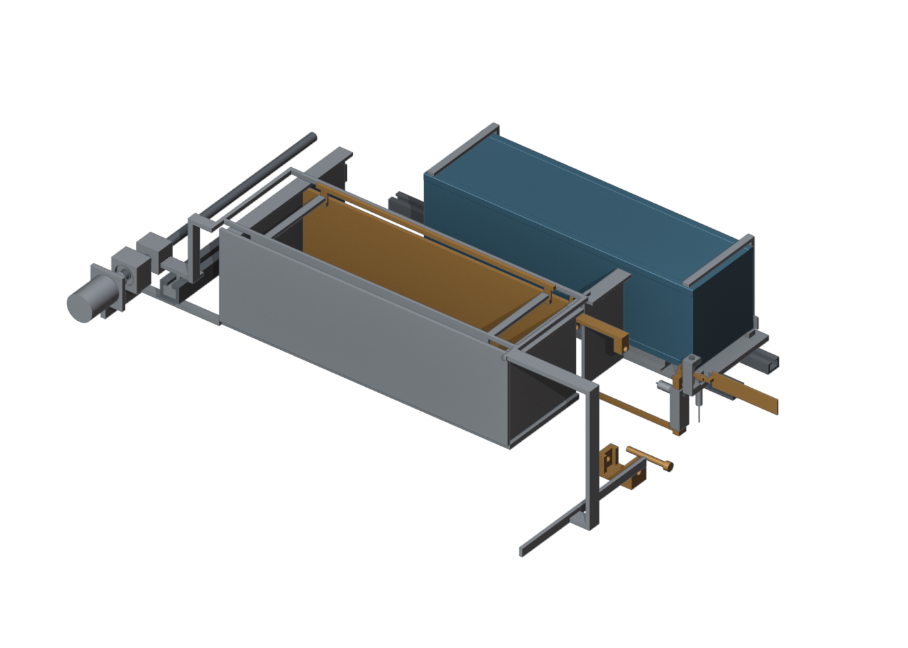
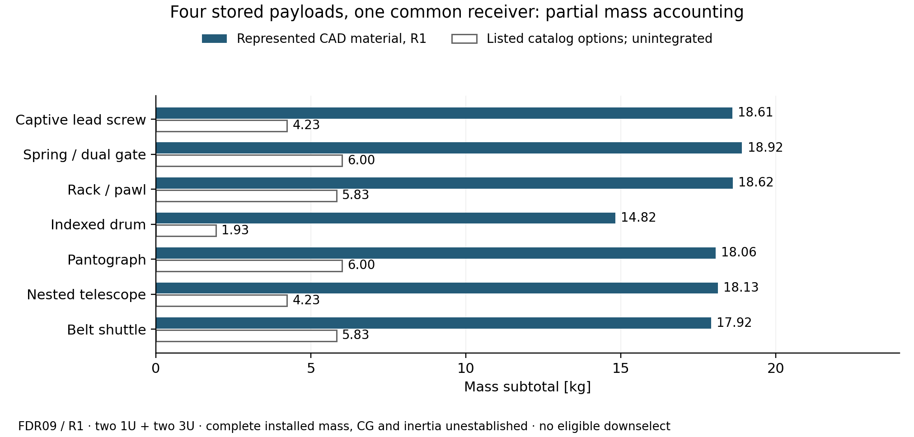

# VOLLEY — Engineering thesis

### VOLLEY: Design and Computational Feasibility Assessment of a Commanded Electromagnetic CubeSat Deployment Mechanism

This repository contains the final-year report, presentation, calculations, CAD and reproducible evidence for the VOLLEY computational study. The academic authors are Adityavardhan Mishra and Pratham Chawla. All evidence needed to examine the report is included locally.

**Report:** [PDF](university/GEN5_FINAL_YEAR_REPORT.pdf) · [Editable DOCX](university/GEN5_FINAL_YEAR_REPORT.docx) · [Source](university/GEN5_FINAL_YEAR_REPORT.md)

**Presentation:** [PDF](university/VOLLEY_Final_Presentation_2026-10-31.pdf) · [Editable PPTX](university/VOLLEY_Final_Presentation_2026-10-31.pptx) · [Slides and evidence map](university/final_review_2026_10_10/README.md) · [Academic evidence](ACADEMIC_EVIDENCE.md) · [Report build](university/README.md)

*Conceptual operating sequence rendered from STEP geometry; motion shown is illustrative. [Animation and source geometry](cad/renders/sequence/README.md).*

## Study configuration

**Gen5** is the fixed evaluated configuration: twelve 4 kg 3U payloads, a 1.3 m powered stroke and a reusable carrier. Its technical evidence snapshot is retained with the assessed design criteria. **Gen6** is a separate development study for passive 1U and 3U spacecraft, initially two of each, with a twelve-payload expansion assessed separately.

The Gen6 mission reference uses a generic maneuvering OTV in approximately 500 km sun-synchronous orbit. Four releases occur within one orbital period; full position and velocity targets are evaluated at a common epoch 24 hours after the last release. Host maneuvers and their resource costs are included for both deployment policies. These are declared surrogates, not provider-approved interfaces.

## Selected feeder design

**FM08-R3 is the selected academic feeder design baseline.** Independent, guided lead-screw pushers transfer payloads from fixed dedicated cells to one indexed receiver. Its toothed-belt indexer disengages through a split clutch before launch and re-engages only after stopped-carrier proof. Fixed 1U spacers remain in their cassettes; a continuous capped channel, a proved-closed receiver far stop and an interlocked transfer sequence define the containment handover. The reference manifest is two 1U and two 3U payloads.

*CAD-derived visualization of the selected academic design; no manufactured hardware or measured performance is shown.*

The [selected-design package](validation/selected_feeder/README.md) contains the controlled geometry, STEP exchanges, selection rationale, calculations and executable sequence checks. Architecture selection is an academic design decision. Physical reliability, environmental qualification and provider approval require later hardware evidence.

## Engineering evidence

*FM06-R1 nominal transfer configuration. Editable geometry, STEP exchanges, calculations and native solver records are included in the [engineering package](validation/feeder_integrity_review/README.md).*

| Evidence | Published result | Interpretation |
|:--|:--|:--|
| Native geometry | 30 assembly poses and 70 individual STEP exchanges | Nominal, prescribed-motion geometry checks |
| Current receiver fixtures | 12 native finite-element analyses | 0.05998 mm mean loaded-face displacement for the 3U one-dog 1000 N ideal fixture |
| Transfer tine | Four native unit-load meshes | 0.010145 mm/N finest-mesh mean compliance under the stated clamp and material assumptions |
| Orbital campaign | 18 targeted schedules and 46 native Orekit replays | Matched finite-force host-control and resource comparisons |

[Native FreeCAD](validation/feeder_integrity_review/cad/FM06_3U_transfer.FCStd) · [Assembly STEP](validation/feeder_integrity_review/cad/FM06_3U_transfer.step) · [Part index](validation/feeder_integrity_review/parts/INDEX.json) · [Load/contact report](validation/feeder_integrity_review/FEEDER_INTEGRITY_REVIEW.pdf)

## Matched orbital delivery

The finite-burn study compares the same constructed terminal states and resource boundary. Under the declared twelve-release 35%/35% policy, the spring input requires 33.83 N peak and 23.12 kg propellant; the imposed VOLLEY release input requires 18.00 N and 6.12 kg. With a common 100 N limit and 30 kg propellant allowance, both policies reach the constructed translational targets. The assumed VOLLEY device-mass premium exceeds its propellant saving in this comparison.

[Method, inputs and native outputs](validation/finite_burn_review/README.md) · [Engineering report](validation/finite_burn_review/FINITE_BURN_CAMPAIGN_REVIEW.pdf) · [Native replay and command sensitivity](validation/native_campaign_review/README.md)

## Electromagnetic and system findings

 

| Gen5 quantity | Result and boundary |
|:--|:--|
| Ideal finite-geometry release screen | 12.448 m/s, with ideal phase and assumed electrical conditions; no component-rated speed |
| Historical periodic-force model | 16.029 m/s; retained as a model comparison |
| Historical modeled dry mass | 126.562 kg, or 10.547 kg per 3U slot |
| Evaluated packaging | 11 mm cassette/track width shortfall; full exact-solid dispositions are retained |
| One-event resource comparison | The evaluated device-mass premium exceeds the modeled propellant saving |

The [finite-force analyses](validation/P121_gen5_finite_force_surface3d.md), [mass/energy audit](validation/P133_gen5_evidence_audit.md), [CAD assessment](cad/GEN5_FULL_INTERFERENCE_AUDIT_2026_10_12.md) and [technical configuration record](docs/GEN5_TECHNICAL_BASELINE.json) define the scope of these results.

## Evidence boundaries

This is a computational design study. No physical prototype, measured release performance or flight qualification is claimed. Fixture compliance uses idealized supports and material assumptions. The earlier FCE08 contact model does not establish dynamic clearance or converged contact loads; its [assessment](validation/feeder_integrity_review/CONTACT_REVIEW.md) records the applicable evidence. FM08-R3 supplies the separately controlled feeder design and its stated analytical and geometric acceptance evidence. Complete hardware integration, measured release/reset behavior and environmental qualification remain outside this computational study.

## Research and development

The [feeder trade](docs/GEN6_FEEDER_CONCEPT_TRADE.md) retains the seven-concept research history. The [current selection](validation/selected_feeder/README.md) adopts a guided lead screw for controlled low-speed pusher transfer; the alternatives remain documented with their applicable limitations. A 1 km/s-class release is a separate long-range scaling objective.

## Reproducibility

Captured studies include source inputs, solver versions, raw outputs, figures and hash manifests. Their local README files specify the required software and replay commands. Native CAD requires FreeCAD; STEP provides the neutral geometry exchange. Blender assets are identified as renders.

Run `python tools/check_review_surface.py` to verify local navigation, manuscript figures, captured values, configuration records and artifact identities. See the linked build instructions for document compilation.

## Project editions

[VOLLEY](https://github.com/aaaaaaaaaaaavm/VOLLEY) · [Thesis](https://github.com/aaaaaaaaaaaavm/VOLLEY-thesis) · [Paper](https://github.com/aaaaaaaaaaaavm/VOLLEY-paper) · [Labs](https://github.com/aaaaaaaaaaaavm/VOLLEY-lab)

Each edition contains its own evidence and documentation. Historical work remains traceable through dated studies and Git history.

## Contact-model verification

The self-contained [FCE12 numerical study](validation/feeder_contact_verification/README.md) includes the native source, twelve-case capture, analytical controls, full-solid pose checks and engineering report. Its final-state sensitivity is included in the current manuscript; it does not establish measured release precision.

## Feeder release and reset geometry

FM07-R5 adds captive receiver pins, a hinged exit gate and prescribed empty-carrier reset. The nominal checks cover 46 cycle poses, 34 rotary samples and 40 continuous linear sweeps. Twenty assembly STEP files and 74 individual parts pass independent exchange readback. These are geometry results; loaded fits, installed actuation and the seven-concept selection gates remain separate requirements.

[Engineering report](validation/feeder_release_review/FEEDER_RELEASE_AND_RESET.pdf) · [Native CAD, STEP, source and checks](validation/feeder_release_review/README.md) · [Selection-gate assessment](validation/feeder_release_review/comparison_reference/D27_GATE_ASSESSMENT.json)

## Rotary clearance and contact-model diagnosis

[RVC01: native CAD and STEP](validation/feeder_rotary_clearance/README.md) supplies the separate FM07-R6 candidate. A 0.25 mm gate relief passes four complete-angle nominal screens; eight assemblies and two gate STEP files have checked exchange records. Loaded fit and actuation remain separate criteria.

[FCE13: source, raw data and reproduction](validation/feeder_contact_diagnosis/README.md) adds six completed native Chrono runs on FM06-R1. Solver and equivalent-geometry refinements do not meet the retained pose criteria; no correction is qualified. The study does not establish a release-precision or contact-force rating.

[Current numerical-evidence index](docs/CURRENT_NUMERICAL_EVIDENCE.md) records the dated native studies and their revision-specific scope.

[Reproducible lunar and high-speed bounds](validation/extended_feasibility_bounds/README.md) separate carrier propulsion from payload release. The compact/low-acceleration combination cannot support the 1 km/s investigation point under the declared surrogate assumptions.

## Common-boundary feeder evidence

[FDR09: seven four-cell CAD/STEP concepts](validation/feeder_common_boundary/README.md) uses two 1U and two 3U payloads with one shared receiver. A separate lead-screw R2 correction clears the checked nominal payload corridor; loaded support, insert custody and full installed-system gates remained open in that dated revision. The separate FM08-R3 selected-design package supersedes FDR09 as the current feeder design reference.

