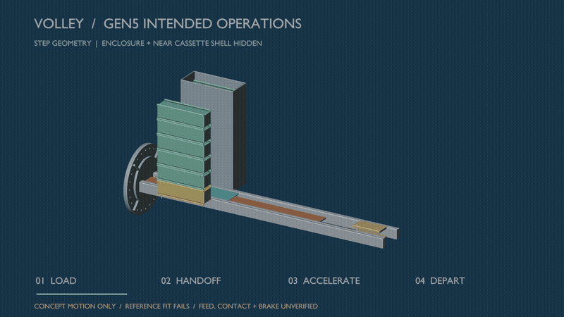
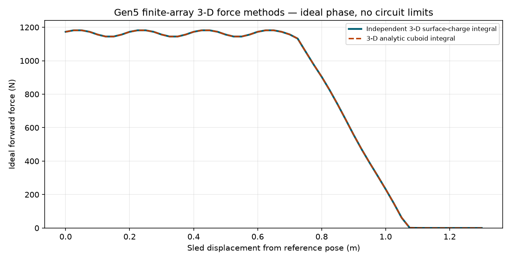
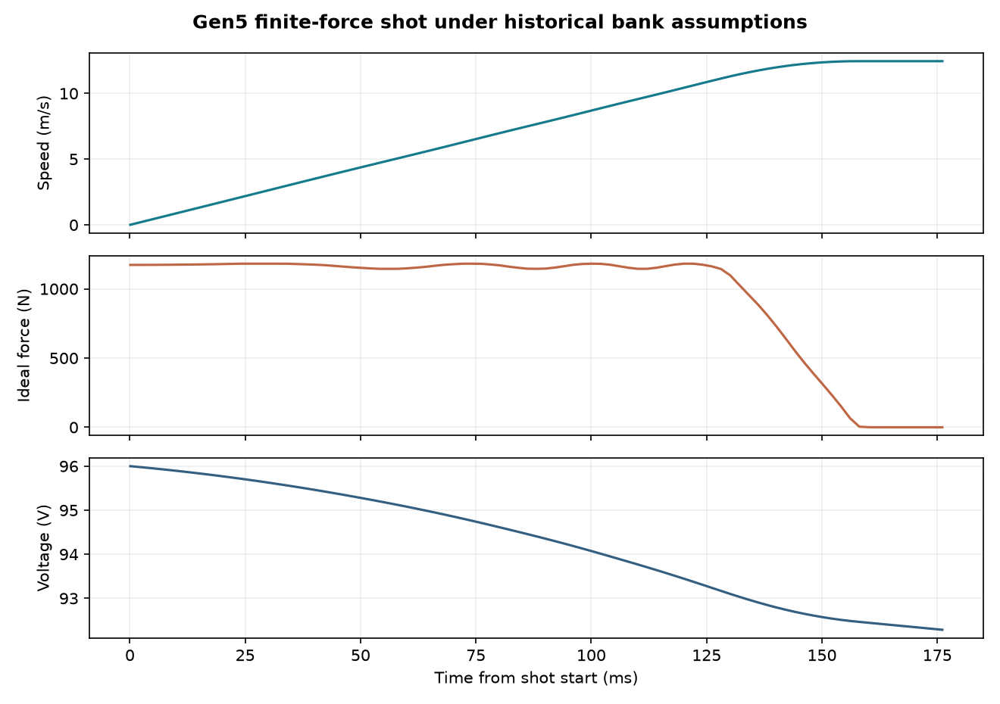
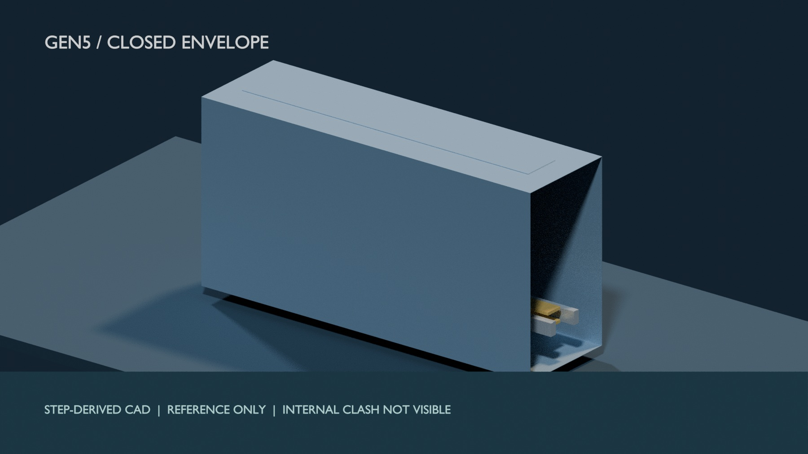
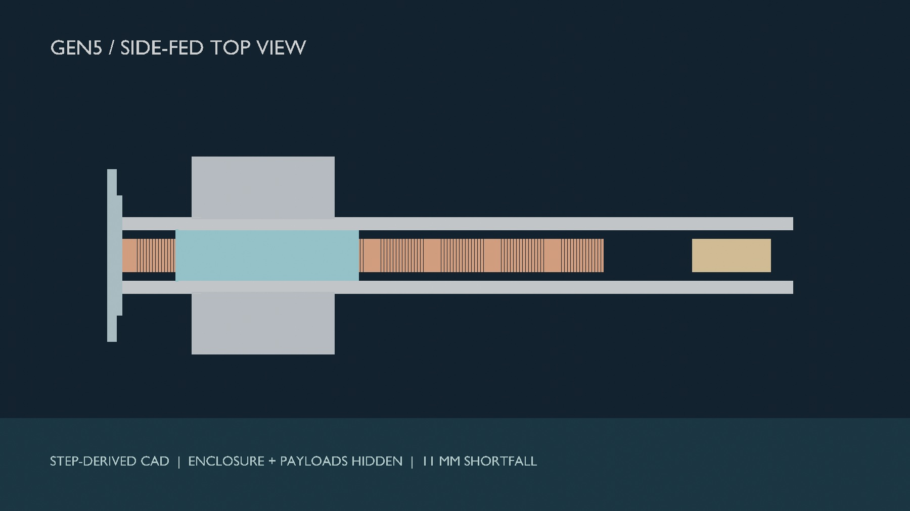
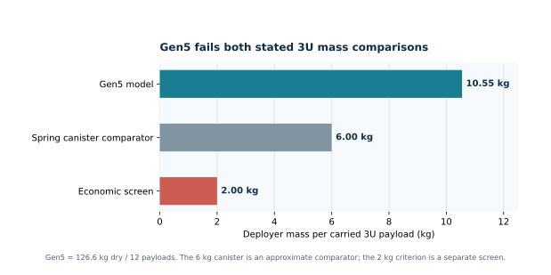
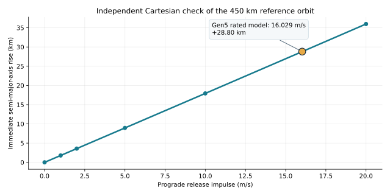
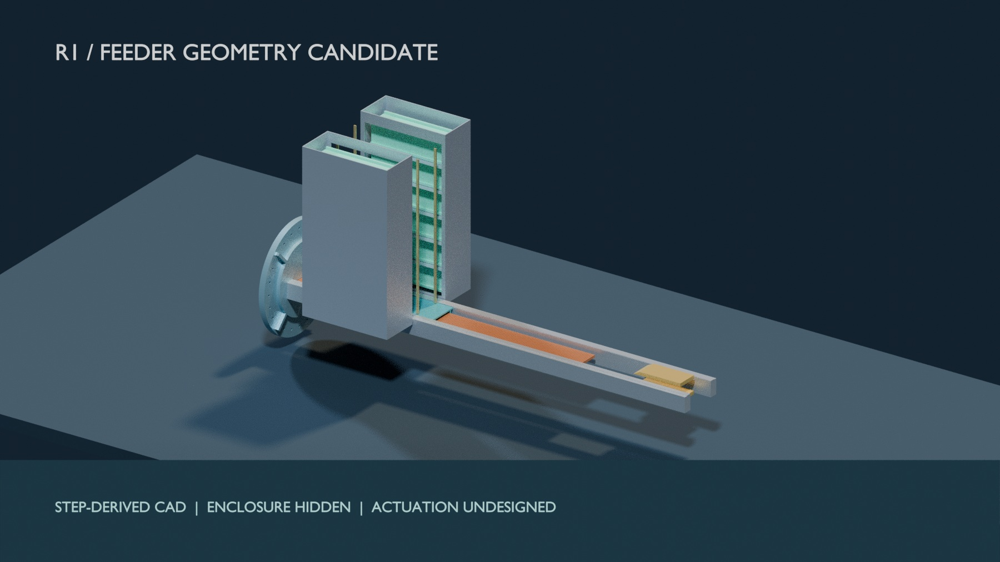

# VOLLEY Gen5 — final-year thesis and review

### A controlled electromagnetic CubeSat deployer configuration, evaluated by computation

This repository is the **standalone academic record** for VOLLEY Gen5. It holds the technical [manuscript](source/VOLLEY_IEEE_Conference.pdf), editable [source](source/paper.tex), model scripts and outputs, CAD, validation sheets, assumptions, defects, and the college [presentation and evidence](university/final_review_2026_10_10/README.md). A professor can follow a slide claim to a result file and method without opening another repository. [Academic release review](GO3_ACADEMIC_RELEASE_REVIEW.md) states which claims are supported and which gates remain open.

The final-year report and presentation are review drafts. No physical working model or department acceptance of the computational demonstration is claimed. Final submission requirements and approvals are managed outside this public research repository.

The earlier claim that waiting 468 seconds alone creates a persistent 30° separation is [withdrawn](docs/PHASING_CORRECTION_2026-10-09.md). The same-epoch two-body correction, [model](analysis/phasing_reference.py) and [run sheet](validation/P113_S16_phasing_correction.md) are included here.

> **Initial Gen6 mixed-size policy screen, P129:** The selected service case is two ordinary passive 1U plus two 3U spacecraft from a rideshare/OTV host, released within one orbit from a 500 km sun-synchronous surrogate. Success is a distinct full position/velocity state for each satellite 24 hours after the last release; host maneuvers are allowed and counted on both sides. The [J2 full-state screen](validation/P129_gen6_mixed_mission.md) constructs four transparent trial targets and shows that simple VOLLEY and spring/host policies both accumulate terminal-state error. It is **not** an optimized campaign or evidence that VOLLEY wins. [Requirements revision 1](docs/GEN6_G0_MISSION_AND_ARTICLE_REQUIREMENTS.md) · [source](analysis/gen6_mixed_mission.py) · [result](analysis/results/gen6_mixed_mission.json) · [figure](figures/gen6_mixed_mission.svg). No Gen6 hardware is built or funded. The current manuscript and report label this as future work, separate from the evaluated Gen5 result.

> **Current Gen6 Go 1 matched campaign, P130:** A public [1U/3U and dispenser reference audit](docs/GEN6_GO1_PUBLIC_REFERENCE_AUDIT.md) distinguishes form-factor precedents from a provider-approved interface. The [matched four-release J2 construction](validation/P130_gen6_matched_campaign.md) lets **both** commanded release and spring-plus-host reach all four target position/velocity states using the same ideal host-burn schedule. At assumed 30 kg versus 16 kg device masses, commanded release saves 3.2823 kg of host fuel but carries a 14 kg device premium; no installed-mass benefit is established. A +0.1 m/s release-speed error shifts the one-day terminal position by roughly 25–27 km. [Source](analysis/gen6_matched_campaign.py) · [result](analysis/results/gen6_matched_campaign.json) · [figure](figures/gen6_matched_campaign.svg). The targets, device masses, host and release range are surrogates; there is no customer tolerance, selected hardware or flight interface. The current manuscript and report include this as future work, without revising the Gen5 result.

> **Gen6 Go 2 engineering screen, P131:** Two native [FreeCAD first-article assemblies and STEP exports](cad/gen6_first_article/README.md) compare captured permanent-magnet and conductive-plate carriers for a passive 4 kg 3U dummy. Both clear five nominal travel stations, but their frame, guide and carrier material proxies already total **9.926/9.945 kg**. Only about **9.35 kg** remains under P130's surrogate mass-parity proxy for the unmodeled drive, source, brake, restraint and controls. At 6 m/s the ideal moving-energy floor is about **82 J**. [P131 calculations and tolerance failure](validation/P131_gen6_go2_article_bounds.md) · [G1 decision](docs/GEN6_GO2_ARCHITECTURE_SCREEN.md) · [source](analysis/gen6_go2_article_bounds.py). **Neither candidate is selected or released for construction.** [P132 source and instrument screen](validation/P132_gen6_go2_power_instrument_screen.md) adds a 6 m/s **818 J** bus-energy floor at an assumed 10% efficiency, an ideal 0.406 F 96-to-72 V capacitance floor, and an illustrative two-gate timing budget. No winding, source or sensor is selected. The current manuscript and report include this as future work, without revising the Gen5 result.

*Geometry review from FreeCAD solids; the drive and brake are unrated space envelopes.*

> **Earlier four-identical-3U G0 screen, P128:** The previous requirements screen declares a four-payload 4 kg 3U, 450 km surrogate with 5–20 km immediate semimajor-axis-rise targets. The [P128 reproducible calculation](validation/P128_gen6_g0_reference.md) needs 2.795–11.149 m/s ideal prograde increments; a 3–6 m/s single-payload first article would measure the mechanism, not complete the 20 km no-burn target. The one-event spring/host mass proxy permits roughly 24.08–24.55 kg of total deployer mass at 3–6 m/s for resource parity under its assumptions. **That earlier G0 is partial and not passed:** there is no named buyer, spacecraft, provider interface, full-state campaign or selected Gen6 hardware. [Source](analysis/gen6_g0_reference.py) · [JSON](analysis/results/gen6_g0_reference.json) · [figure](figures/gen6_g0_reference.svg). The current manuscript and report label this as future work, separate from the evaluated Gen5 result.

> **Scope, October 2026:** Gen5 is the fixed computational configuration for academic review, with documented model cases and open verification items. It yields a modeled orbital benefit, a failed installed-mass criterion, and a failed side-fed CAD fit. The final academic freeze has not been declared; nothing has been built, fired, measured, qualified or flown. Gen6 is the proposed first mission-derived instrumented prototype programme; 1 km/s-class release is separate long-range research. It has no selected architecture or achieved speed.

*The intended order of operations, shown with local FreeCAD-linked STEP solids. The enclosure and near cassette shell are hidden. The evaluated reference assembly has a known track/cassette clash; feed, contact and brake motion are unverified. [Watch the eight-second sequence](cad/renders/sequence/gen5_intended_sequence.mp4) · [view animation provenance](cad/renders/sequence/README.md) · [inspect the static geometry audit](cad/renders/step_review/README.md). This is a model visualization, not hardware.*

> **Finding for the examiner:** the finite 3-D analytic force screen gives **12.448 m/s under ideal phase**, challenging the earlier **16.029 m/s** periodic-model shot. A separate 2-D FEM screen finds **1.082 kJ** ideal work. A conditional finite-force bank calculation gives **2.099 kJ** gross for the assumed full winding. None establishes a selected motor rating. [3-D analytic screen](validation/P118_gen5_finite_force_map.md) · [2-D FEM](validation/P119_gen5_finite_force_fem2d.md) · [coupled bank case](validation/P120_gen5_finite_coupled_shot.md) · [affected-claim disposition](docs/GEN5_2026_10_09_FINDING_DISPOSITION.md).

> **New cross-check and sensitivity:** an [independent depth-resolved 3-D surface-charge formulation](validation/P121_gen5_finite_force_surface3d.md) returns **1.042 kJ ideal work**, agreeing with the analytic finite-force screen under shared geometry and material assumptions. [Illustrative geometry cases](validation/P122_gen5_finite_force_sensitivity.md) reduce ideal work to **0.907 kJ at a 14 mm face gap** versus 12 mm nominal. These are computational screens, not measured tolerances or an accepted speed rating.

> **Updated finding for the examiner, 10 October 2026:** [P123](validation/P123_gen5_one_event_mass_screen.md) calculates a one-release installed-mass trade with the same assumed host and payload. The ideal finite-force Gen5 case saves **1.866 kg** of fuel if both options carry 10 kg, but its modeled device is **54.562 kg** heavier. With fuel hypothetically resized for only one event, Gen5 remains **52.717 kg** heavier on the device-plus-fuel proxy. Achieving parity at this ideal speed requires about **52.630 kg** less device dry mass. [Code](analysis/gen5_one_event_mass_screen.py) · [result JSON](analysis/results/gen5_one_event_mass_screen.json). This does not close a twelve-shot mission or validate a motor. The manuscript, report and review deck now include the limited P123 result and the later P125 source-power failure, P126 assumed R1 tolerance and P127 arrest bound.

> **Additional viva bound:** even if an ideal release removed the host preburn entirely, the same one-event comparison allows at most **74.659 kg** of Gen5 device against the current 126.562 kg model. [Recompute it locally](analysis/gen5_architecture_bounds.py) · [read the unselected H1 hypothesis](docs/GEN5_H1_INTEGRATED_DEPLOYER_HYPOTHESIS.md). The manuscript and report include the bound; H1 remains unselected.

> **New examiner requirements screen, P124:** [orbit and stroke calculations](validation/P124_precision_delivery_design_space.md) show how a declared 450 km orbital-state tolerance becomes an ideal tangential velocity margin. They also give about **39,220 g** for 1 km/s over Gen5's 1.3 m stroke with a 4 kg payload. This is a kinematic screen, not a motor rating or qualified load. The report, manuscript and slide 23 now include the result. [Code](analysis/precision_delivery_design_space.py) · [result](analysis/results/precision_delivery_design_space.json).

The [P127 release/arrest bounds](validation/P127_gen5_release_arrest_bounds.md) find 731.8 J of sled kinetic energy at the **ideal** finite-force speed. Over the provisional 210 mm brake corridor, stopping it needs at least 37.6 g mean sled deceleration; the first-order host reaction and net recoil are also bounded. Eddy-current peak force, payload contact, host attitude and repeated-shot thermal behavior remain unsolved.

> **P125 drive feasibility screen:** A quasi-steady, three-phase voltage/current model uses the finite Gen5 force map and the historical **unselected** winding and 96 V source. The reference surrogate reaches 12.448 m/s; halving the current limit gives 8.802 m/s and halving the initial source voltage gives 10.794 m/s. A single string at the older 116–185 mΩ commercial ESR bound **fails the source-power equation before release**; ideal parallel-string branches complete while multiplying source cells and mass. These are conditional model outputs, **not a rated release speed or selected drive**. [Method and limits](validation/P125_gen5_voltage_limited_screen.md) · [source](analysis/gen5_voltage_limited_screen.py) · [result](analysis/results/gen5_voltage_limited_screen.json).

The [prototype-to-flight decision gates](docs/GEN6_PROTOTYPE_TO_FLIGHT_ROADMAP.md) make the proposed Gen6 first article and later engineering, qualification and flight stages reviewable. None is an achieved Gen6 milestone.

 

 

*The FEM omits magnet-depth end effects and the coupled shot retains assumed bank, converter and ideal phase. The [matched reference](docs/MATCHED_MISSION_REFERENCE.md) uses assumed host and dispenser properties; none of its spring or Gen5 twelve-shot cases closes.*

*Model and mission architecture. A host and provider interface have not been selected.*

## Bring this to the final review

| Deliverable | Open it | Evidence route |
|:--|:--|:--|
| **26-slide college presentation** | [PDF](university/final_review_2026_10_10/VOLLEY_Final_Review_2026-10-10.pdf) · [editable PPTX](university/final_review_2026_10_10/VOLLEY_Final_Review_2026-10-10.pptx) | [Slide-by-slide claim map](university/final_review_2026_10_10/CLAIM_EVIDENCE_MAP.md) |
| **Panel handbook** | [PDF](university/final_review_2026_10_10/PANEL_HANDBOOK.pdf) · [Markdown](university/final_review_2026_10_10/PANEL_HANDBOOK.md) | Detailed explanations and figures |
| **Final-year project report** | [PDF](university/GEN5_FINAL_YEAR_REPORT.pdf) · [Markdown](university/GEN5_FINAL_YEAR_REPORT.md) | Chaptered academic review draft; college-specific format remains to be applied |
| **Technical manuscript** | [PDF](source/VOLLEY_IEEE_Conference.pdf) · [LaTeX](source/paper.tex) | [Local evidence guide](ACADEMIC_EVIDENCE.md) |
| **Engineering review reports** | [Computational PDF](reports/GEN5_COMPUTATIONAL_REVIEW.pdf) · [FreeCAD/CAD PDF](cad/GEN5_CAD_REVIEW.pdf) | [Orbit check](validation/P115_rated_orbit_cartesian.md) · [Assembly check](validation/P116_gen5_assembly_packaging.md) |

The presentation pack credits **Adityavardhan Mishra and Pratham Chawla**, with guide **Vikas Gulia**. The existing technical manuscript names Adityavardhan Mishra; the review pack does not retroactively change its authorship. [Remaining CAD and IEEE work](IEEE_AND_CAD_REMAINING_WORK.md) · [IEEE prior-art update](IEEE_PRIOR_ART_UPDATE_2026-10-09.md) · [Manuscript claim audit](CLAIM_CORRECTIONS_2026-10-09.md) · [Pack instructions](university/final_review_2026_10_10/README.md) · [Review-pack checksums](university/final_review_2026_10_10/CHECKSUMS.sha256) · [Academic artifact checksums](ARTIFACT_MANIFEST.sha256).

To rebuild the chaptered report from this repository, run `pandoc university/GEN5_FINAL_YEAR_REPORT.md -o university/GEN5_FINAL_YEAR_REPORT.pdf --pdf-engine=xelatex --resource-path=university`. Its source includes the page format and font settings. The PDF and deck are academic review drafts; neither represents approval or final submission.

**Market context for the viva:** [audited customer and spacecraft fit](MARKET_AND_CUSTOMER_FIT.md). It checks the relevant Drive market report and independent business-case review against primary industry sources and the Gen5 result. Candidate buyers and satellite classes are hypotheses, not endorsed customers or qualified payloads.

## The result to defend

Gen5 is one specified system: a release station 1.5 m from the breech on 1.8 m structural longerons, with a 1.3 m powered stroke, ironless double-sided Halbach linear motor, reusable permanent-magnet sled, pulse store, eddy-current arrest and two conceptual cassettes for twelve ordinary 3U CubeSats. The release load and mechanical/electrical compatibility of any actual CubeSat remain unqualified.

 

*Gen5 CAD models. These depict the evaluated geometry; they are not built articles or manufacturing drawings. [Inspect local CAD](cad/).*

| Study question | Modeled Gen5 answer | Examiner's qualification |
|:--|--:|:--|
| Historical rated 3U departure | **16.029 m/s at 10.07 g** | Periodic model challenged by finite geometry; not a measured command range or payload qualification |
| Energy draw | **2.78 kJ gross per shot** | Circuit model at the rated point |
| Exit-speed dispersion | **0.0274 m/s (3σ)** | Simulation under assumed sensor uncertainty |
| Dry / loaded design mass | **126.6 / 174.6 kg** | Modeled rollup with historical Gen3 sled volumes and assumed components, not a complete installed host mass |
| Mass per carried 3U | **10.547 kg** | **Fails** the approximately 2 kg/satellite economic screen |
| Incumbent canister parity | **1.758×** a roughly 6 kg/3U canister | **Fails** the separate ±15% parity band |
| One modeled 450 km orbit case | **28.8 km** semi-major-axis rise; **1.60×** lifetime | Conditional atmosphere and orbit assumptions; current lifetime point lacks an independent rerun |
| Current rated two-body cross-check | **28.800775 km** immediate axis rise | Independent Cartesian propagation; lifetime, host and delivery excluded |
| Side-fed reference assembly fit | **11 mm shortfall** | FreeCAD and CadQuery exact solids collide by 32,915 mm³ per cassette |

[Frozen numerical baseline](appendix/BASELINE.md) · [Claim provenance](appendix/PROVENANCE.md) · [Study limits and viva questions](ACADEMIC_EVIDENCE.md) · [Defect register](appendix/OPEN_PROBLEMS.md)

 

*These review charts are generated by the local [plot script](tools/plot_gen5_decision.py) from [mass](analysis/results/mass_properties.json) and historical [shot](analysis/results/motor_results.json) outputs. The canister value is approximate; [P117](validation/P117_rated_energy_mass_audit.md) reconciles the old 124.488 J compact-output remainder to model assumptions. This does not verify installed power hardware.*

 

*The CAD finding is deliberately retained in the [native FreeCAD document](cad/native/Gen5_Review.FCStd) and [assembly STEP](cad/step/gen5/VOLLEY_Review_Assembly_FreeCAD_Gen5.step). The orbit check supports immediate two-body geometry only. [Methods and exact files](reports/GEN5_COMPUTATIONAL_REVIEW.pdf).*

The [P126 R1 tolerance screen](cad/FEEDER_R1_TOLERANCE_SCREEN.md) finds 1.31 mm residual for an assumed 0.2° alignment band and −0.47 mm for 0.5° against the R1 CAD-derived 5 mm nominal side gap. These bands are illustrative; moving hardware and flight tolerances remain unselected.

*The [R1 FreeCAD and STEP geometry study](cad/FEEDER_CANDIDATE_R1.md) widens the enclosure and clears twelve scripted 3U envelope paths. Lift actuation, launch retention, tolerances, mass revision and provider compatibility remain open; R1 is not a selected Gen5 configuration.*

  

*Field → shot → mass decision. Independent numerical methods check specific model quantities; none is an experimental Gen5 validation.*

## Method and traceability

| Evidence layer | What is here | What it does not establish |
|:--|:--|:--|
| [Analysis](analysis/) | Executable electromagnetic, shot, mass and orbit models with captured result JSON | Correctness of unknown material, sensor or host inputs |
| [Validation](validation/) | Predeclared acceptance bands, numerical solver cross-checks, failed bands | Hardware repeatability or flight qualification |
| [CAD](cad/) | Gen5 geometry, STEP parts and mass properties | Fabrication readiness, fit to an approved host or full tolerance stack |
| [Appendix](appendix/) | Baseline, prior art, literature, provenance, decisions, defects | External endorsement |
| [Final-review claim map](university/final_review_2026_10_10/CLAIM_EVIDENCE_MAP.md) | Each slide's local evidence and caveat | Replacement for the underlying run sheet |

The analysis and reference files began as a dated engineering snapshot and now include local P115/P116 checks and FreeCAD exports. The manuscript, review pack and this examiner-facing guide are authored here. The local files define the academic claims; a later change in another repository does not silently alter them.

Run `python3 tools/check_review_surface.py` for a fast, dependency-light check of the current academic route: local links, manuscript figures, captured-result identities, artifact hashes and PDF/ZIP integrity. Historical copied validation and appendix records retain some links to a wider programme archive; the presentation's current numerical claims use the local sources in the claim map.

## The academic boundary

The result is a **documented computational study with a negative selection screen for the evaluated 3U configuration**. Integrated thrust, the coupled shot chain, and other engineering closures remain open. The lack of a physical prototype is stated directly; published tests of other devices support context or parameters, not claims that VOLLEY itself was tested. The college rubric includes objectives, technical quality, results/validation, documentation, and presentation/viva. The supplied example deck gives a visual and section outline; it does not supply technical evidence for VOLLEY. [Review-pack rubric mapping](university/final_review_2026_10_10/README.md).

The manuscript uses an IEEE conference layout. A university-specific full-thesis template has not been supplied, and no claim is made that this PDF satisfies an unprovided submission format. The review presentation and academic evidence record are ready for scrutiny of their stated computational scope.

**Beyond Gen5:** [Gen6 direction](university/final_review_2026_10_10/GEN6_DIRECTION.md) frames 1 km/s as a research objective. A named host and ICD, complete installed-system model, payload-specific structural and release testing, repeated shots and full mission closure are future gates. [VOLLEY engineering](https://github.com/aaaaaaaaaaaavm/VOLLEY) and [paper companion](https://github.com/aaaaaaaaaaaavm/VOLLEY-paper) offer optional context; this repository contains the evidence needed to review this thesis.
