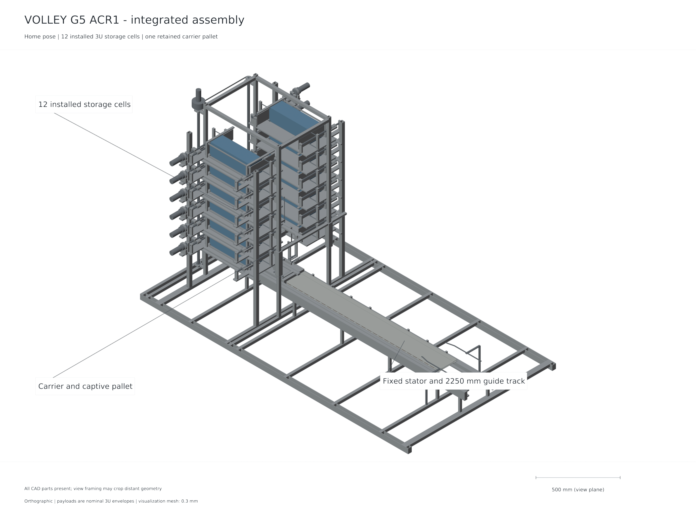
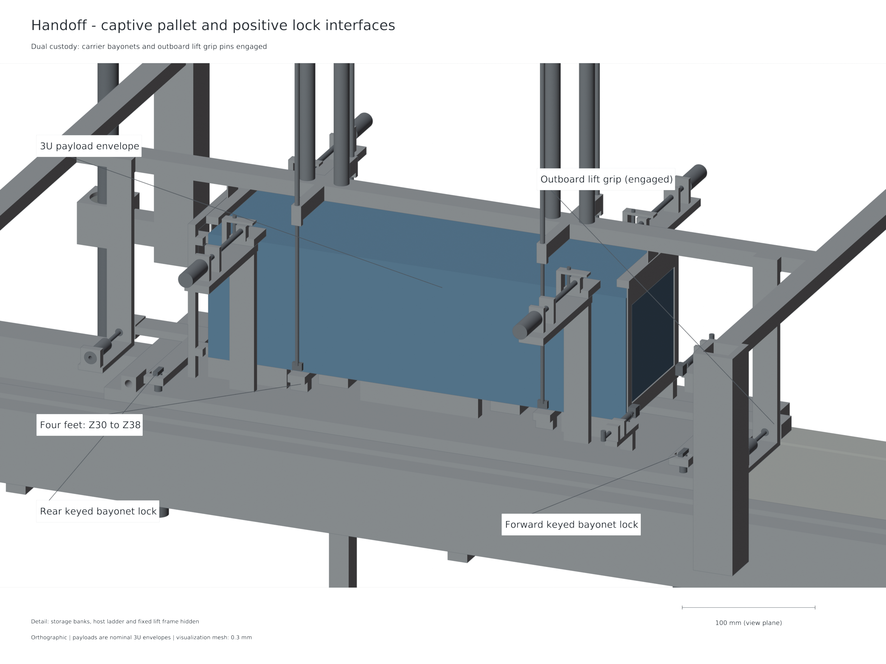
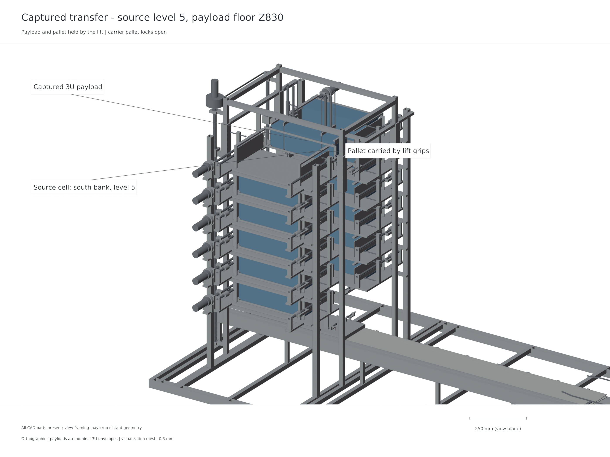
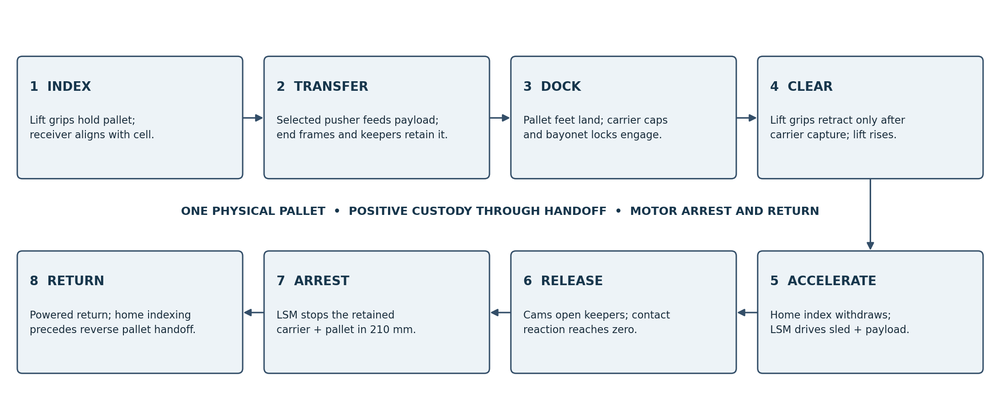
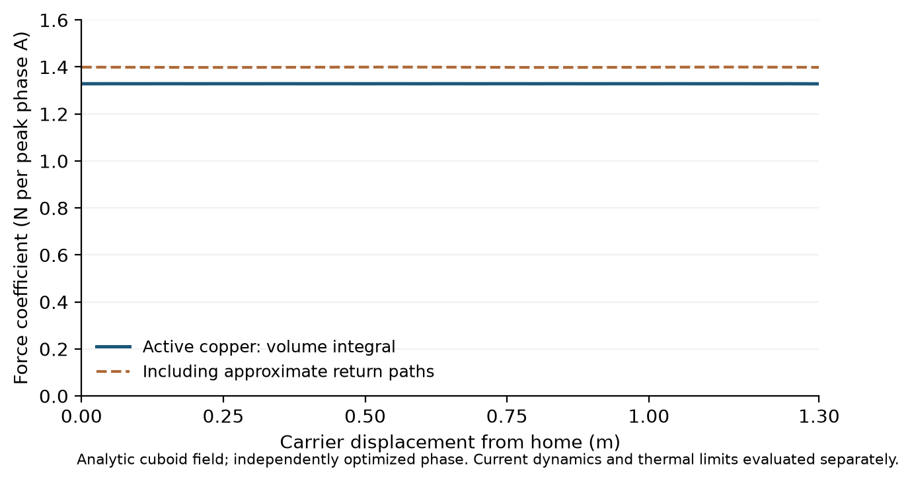
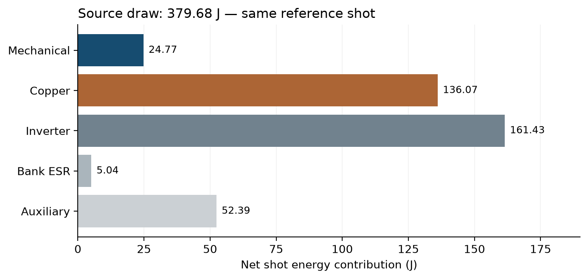
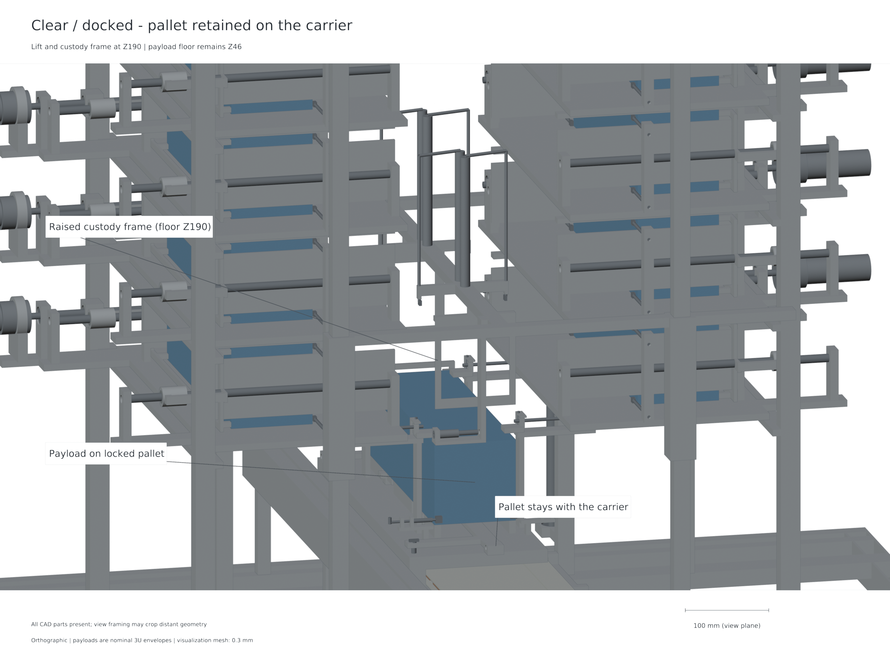

# Abstract {.unnumbered .unlisted}

VOLLEY is a commanded electromagnetic deployment mechanism intended to assign individual relative release velocities to CubeSats carried by a manoeuvring host. This study develops and computationally evaluates the Gen5 ACR1 reference design for twelve 4 kg, 3U envelope surrogates. Two fixed six-cell banks feed a vertically indexed captive pallet, which docks positively to a reusable permanent-magnet sled. A finite three-phase stator accelerates the payload and sled; passive cams open the forekeepers before release, and the same linear synchronous motor arrests and returns the sled. Eight native and STEP configuration states and 154 accepted motion/refinement checks support nominal geometric compatibility. Solid-volume accounting gives 149.557 kg dry represented CAD mass and 197.557 kg with twelve payloads; a separate 7 kg power/control allowance is retained. Three-dimensional finite-magnet force integration gives approximately 1.328 N/A from active conductors and 1.399 N/A including represented returns. An independent source-face integration corroborates the active force, while finite-element current-distribution integration differs by 0.172% at the checked interior station. The principal 3 m/s source case passes all six nominal/adverse and 3/20/100 µH inductance combinations in an independently audited 5 µs time-step rerun, with arrest within the allocated 210 mm. Actual-chassis elasticity under opposed 3.010 kN array loads gives 0.286 mm paired gap closure, increasing to 0.372 mm under a declared 1.3 load multiplier. Together, these results support a computational operating study over 1–3 m/s and identify the source, mechanical custody and host resources required for it. Manufacturing, payload compatibility and environmental performance remain subjects for physical validation. A mixed 1U/3U prototype and higher-speed scaling are proposed as Gen6 development.

**Keywords:** CubeSat deployment; linear synchronous motor; finite magnetic field; payload custody; coupled electromechanical simulation; computational design.

# Abbreviations and notation {.unnumbered .unlisted}

| Symbol or term | Meaning |
|:--|:--|
| ACR1 | Gen5 reference revision evaluated in this report |
| CAD / STEP | Computer-aided design / ISO 10303 solid exchange |
| CG / ICD | Centre of gravity / interface control document |
| FEM / FEA | Finite-element method / finite-element analysis |
| LSM / PWM | Linear synchronous motor / pulse-width modulation |
| ESR / SVPWM | Equivalent series resistance / space-vector PWM |
| $x$, $v$, $I$ | Relative travel, relative speed, peak phase current |
| $K_t$, $K_e$ | Position-dependent thrust and back-emf coefficients |
| $L$, $R$, $C$ | Effective winding inductance, resistance and source capacitance |
| $m_p$, $m_s$, $M_h$ | Payload, retained sled and remaining host masses |

: Abbreviations and principal notation.

\clearpage
\pagenumbering{arabic}

# Introduction and problem definition

## Commanded release from a hosted manifest

CubeSat deployment is an interface between a launch or transport platform and a free-flying spacecraft. A deployer must retain a payload before command, guide it along an agreed contact path, produce separation, and leave both spacecraft in acceptable states. Conventional spring dispensers provide this function with a compact mechanism and substantial operational heritage [1,2]. Where the mission requires distinct release conditions for individual members of a manifest, controllable velocity becomes an additional design variable.

A manoeuvring host can change its own orbit before release. A commanded deployer adds a local relative velocity at the release event. These actions affect different parts of the delivery problem: host manoeuvres establish the carrier state, while the deployment impulse establishes the payload state relative to that carrier. Along-track release changes orbital energy and period; a cross-track component changes the orbital plane to a much smaller extent for the same low relative speed. The useful direction and magnitude depend on the target states and the host's available resources [3,9].

VOLLEY investigates this additional release control through a reusable moving-magnet LSM. The payload remains a passive envelope surrogate; added magnet arrays and motor elements belong to the retained sled. This arrangement concentrates the electromagnetic hardware on the host, allowing the same motor and carrier to serve successive payloads. It also creates a substantial retained moving mass, an arrest requirement and a payload-transfer problem. These consequences form part of the design rather than being omitted from the velocity calculation.

## Research question and approach

The research question is whether a mechanically explicit twelve-payload configuration can provide low-speed commanded release when its finite motor geometry, actual retained moving mass, selected source reference and post-release arrest are evaluated together. The study answers this question through a controlled reference assembly, a defined custody sequence, numerical force and current models, a coupled shot model and structural and mission analyses.

The system analysis follows the complete operating cycle. Finite motor force is coupled to current delivery, back emf, source impedance, load resistance and retained moving mass. The release event changes the mechanical connection between payload and carrier; the carrier then stops inside the rail allocation and returns for the next payload. Throughout transfer, the pallet remains supported by the lift or positively captured by the carrier. Geometry, source and motion models follow these dependencies.

## Study outcome

The selected Gen5 ACR1 architecture combines fixed storage banks, positive lead-screw feeding, vertical indexing and a single captive docking pallet. The powered carrier retains that pallet throughout launch, arrest and return. Nominal geometry is represented in eight native and STEP states, with the transfer and release motions supplemented by 154 accepted checks. The source-coupled study supports commanded cases from 1 to 3 m/s, with the 3 m/s case receiving the full time-step audit. The resulting system is a completed computational design reference for subsequent prototype work.

{width=100%}

# Objectives and study scope

## Design objectives

The first objective is to define a complete payload path from an individually retained storage cell to free departure. The path must state which element carries and restrains the payload during each transfer. The second objective is to evaluate finite electromagnetic force using the actual winding and magnet arrangement. The third is to couple that force to a stated electrical source and moving-mass model, including the change in dynamics at release and the arrest of the retained carrier. The fourth is to relate release conditions to a host and mission boundary that includes the deployer's installed burden.

| Objective | Implemented method | Reported evidence |
|:--|:--|:--|
| Define repeatable payload custody | Fixed cells, indexed pallet, positive carrier capture | CAD states, lock sequence and motion checks |
| Quantify finite motor force | Cuboid-field Lorentz integral, source-face check, current FEM | Force-position coefficients and numerical comparisons |
| Assess source and shot compatibility | Averaged three-phase current/source model | Release, current, voltage, loss and arrest results |
| Check magnetic loading of carrier | Actual connected-chassis elasticity | Paired face-separation reduction |
| Account for retained burden | Named solid-volume ledger and separate allowance | Dry, loaded and moving-mass totals |
| Assess delivery implications | Common mission boundary and host recoil | Chapter 8 mission analysis |

: Objectives, methods and evidence.

## Reference requirements and interfaces

The reference manifest comprises twelve identical 4 kg rectangular 3U surrogates, each 340.5 × 100 × 100 mm. Dimensions describe the represented contact envelope; compliance with a specific flight spacecraft interface requires a customer ICD [2]. Two six-cell banks provide individually identifiable storage positions. Positive retention must continue through cell opening, transfer, docking, acceleration and controlled release. The rail allocation provides a release station at carrier-aft X1500 mm and 210 mm of post-release arrest travel.

The host is a generic manoeuvring platform. It must provide electrical charging, command and inhibit interfaces, attitude management, structural accommodation and the resources needed to execute the mission. A selected launch provider or carrier is outside the reference definition. This allows the mechanism and mission calculations to state their assumptions without implying acceptance by a particular vehicle.

## Scope and interpretation

This is a computational design and evaluation study. The evidence consists of native CAD and exchange geometry, analytical calculations, finite-element solutions, coupled simulations and independent numerical checks. The 149.557 kg dry value is represented CAD material mass. The explicit 7 kg power/control allowance is additional to it; neither quantity is a manufacturing or weighed mass. Catalog components provide engineering reference data under their documented conditions. They do not establish vacuum, radiation, lifetime or complete product qualification.

The supported speed range is the set of analysed 1–3 m/s commands. The principal 3 m/s case is reviewed across nominal and adverse assumptions and three inductance values. The scope does not assign a robust 4 or 4.5 m/s rating, and 6 m/s is outside the selected current operating study. Tolerance allocations, contact laws and thermal properties are stated model inputs; their correlation requires a physical article. No measured VOLLEY prototype performance is reported. These boundaries apply to all results in this report.

# Literature review and research contribution

## Conventional deployment and mission control

The JEM small-satellite deployment interface and the CubeSat Design Specification provide relevant context for payload envelopes, retention and deployment interfaces [1,2]. They establish the need for agreed contact features and operating boundaries. Such specifications must be applied at the customer interface; a generic 3U envelope does not replace their detailed requirements.

Differential drag is an established method for constellation phasing, including operational work on Planet spacecraft [3]. It changes relative motion gradually through differences in ballistic behaviour. A release impulse also changes relative motion, but acts at a specific event and requires host recoil and payload-interface accounting. A comparison must therefore specify a common delivery objective and time horizon. A larger deployment speed is useful only where it reduces resources or meets a delivery requirement that the alternative cannot meet at an acceptable system cost.

## Electromagnetic release and storage mechanisms

Electromagnetic CubeSat deployment is established prior art. Zhao and colleagues describe stacked storage, magnetic transfer and multiple release windows in their 2022 deployer study [4]. Their gravity-compensated laboratory release results include 1 kg dummy speeds of approximately 0.67–1.42 m/s and 3 kg speeds of approximately 0.40–0.85 m/s for the tested current range. Those values are measured results for that mechanism and its test conditions. They provide a useful precedent for test observables rather than a measurement of the present design.

The 2025 high-volume storage study describes stack pushing, receiving guides, magnetic capture and transport [5]. Its architecture includes spacecraft-side grooves and iron patches. That interface differs from the passive rectangular payload assumption used here. Its approximately 1200 N receiving contact peaks belong to the reported zero-gravity simulation; the faster laboratory pushes are gravity-assisted. The comparison demonstrates why endpoint arrival, contact force and environmental conditions must be identified separately when assessing a transport mechanism.

Feng and colleagues study a higher-speed on-orbit electromagnetic launcher and reachable domain [6]. The acceleration, payload interface and operating regime differ from the present low-speed retained-carrier architecture. High-speed electromagnetic studies establish context for scaling but do not supply a compatible low-acceleration motor rating. For VOLLEY, the design question concerns the coupled release, custody, source and host burden at a modest commanded speed.

## Finite motors and numerical methods

Halbach's permanent-magnet arrangement supplies the field concept underlying the opposed arrays [7]. A periodic wave is useful for initial sizing, while a finite winding and finite magnet array introduce longitudinal end effects. Yamaguchi and Morishita discuss these effects in Halbach field-magnet linear motors [8]. Their relevance here is methodological: the finite geometry must enter the force model at launch and arrest positions.

The present study integrates the Lorentz force over represented conductors using finite magnet sources. It checks the active-conductor result through an independently implemented source-face formulation, and checks the current-distribution approximation through a conduction finite-element solution. These comparisons have distinct roles. Agreement between field formulations tests implementation of the stated magnet model. A current FEM examines whether the represented conductor paths justify uniform bar and approximate-return currents. Neither comparison supplies a physical field or force measurement.

## Contribution of the present study

The contribution is the integration and evaluation of a specific commanded deployment mechanism: twelve fixed 3U cells, a vertically indexed captive pallet, retained moving magnets, passive pre-release keeper opening, source-limited actuation and active post-release arrest. The work provides source-linked geometry, mass and model results for the same reference revision. It establishes which operating cases satisfy the declared computational checks and which interfaces require physical validation. Adjustable electromagnetic ejection, stacked storage and programmable deployment are not claimed as new principles.

# Research methodology and governing models

## Configuration and dependency control

The reference identifier is VOLLEY-G5-ACR1. The mechanical capture records the builder and parameter hashes used for the eight state exports. Native part identities, connected-solid status, positive-volume interference checks and the number of physical pallets are retained with each state. A separate mass ledger is extracted from the same released geometry. Electromagnetic, source and structural results retain their input hashes and method definitions so that a numerical value can be traced to the geometry or data that produced it.

The analysis sequence follows physical dependencies: geometry defines contact paths and conductor/magnet positions; geometry and densities define moving mass; force and resistance define electrical demand; source and controller limits define the shot; release changes mechanical connectivity; arrest defines retained-carrier travel; mission calculations use the achieved model release envelope and retained installed mass. This order avoids substituting a velocity from one configuration into the mission model of another.

## Electromagnetic force and phase convention

For represented copper volume $V_{Cu}$, current density $\mathbf J$ and permanent-magnet field $\mathbf B$, longitudinal force is

$$F_x(x,I,\phi)=\int_{V_{Cu}}(\mathbf J\times\mathbf B)_x\,dV.$$

The three phase currents are balanced sinusoids and $I$ denotes peak phase current. Position-dependent phase coefficients are combined at the specified electrical phase. The force coefficient therefore has units N per peak phase ampere. Active transverse bars and longitudinal returns are reported separately because their approximations differ. Coordinate mapping between field and CAD systems is explicitly recorded: field X is travel, field Y is gap and field Z is depth; CAD uses X travel, Z gap and Y depth.

A source-face magnetic-charge formulation independently computes the active force by numerical integration of magnet faces and exact depth integration. Quadrature refinement distinguishes numerical integration effects from differences in physical assumptions. The conduction FEM solves the actual connected copper paths and integrates its current density against the permanent-magnet field at a selected interior station.

## Coupled electrical and mechanical model

A lumped electrical description expresses the relation between phase voltage, winding resistance, inductance and back emf:

$$L\dot I_q=V_q-RI_q-K_e(x)v.$$

The production implementation retains its own balanced three-phase conventions and source-power conversion. The capacitor source is represented by its capacitance and ESR, with terminal voltage obtained from the Thevenin relation. Requested power must have a feasible physical source root. During regeneration, terminal voltage is capped at 92.8 V, equivalent to 2.9 V per cell in a 32-series arrangement. With internal capacitor voltage $V_c$, source resistance $R_s$ and cap $V_{lim}$, the signed source-power lower bound is

$$P_{dc}\geq\frac{V_{lim}(V_c-V_{lim})}{R_s}.$$

This condition prevents the braking command from imposing excess charging terminal voltage. Positive source power, modulation voltage and phase current have separate limits. PWM ripple is bounded explicitly around the mean current; transistor switching itself is not resolved.

The moving payload and carrier interact through unilateral rear contact. A compressive normal reaction can accelerate the payload; that contact cannot pull it back. Electrical braking is commanded first, and mechanical separation occurs when the computed reaction reaches zero. Attached and detached reduced masses are used on the appropriate sides of that event. The retained carrier then decelerates under the same finite motor's arrest force map.

## Energy, numerical verification and structural loading

Mechanical work is evaluated from the signed motor force and relative displacement. Electrical energy is apportioned to mechanical change, copper, inverter, bank and auxiliary terms. An energy residual checks consistency of the time integration and event handling. The independently audited time-step rerun refines the production 20 µs step to 5 µs for all six principal 3 m/s cases and reconstructs the reduced-mass work balance independently. The rerun uses an instrumented copy of the production simulation function; its audit independently checks algebra, source roots, limiting logic and conservation quantities.

The actual connected carrier chassis is solved under opposed magnet attraction. The model assumes linear elasticity with $E=70$ GPa and $\nu=0.33$. Surface integration applies equal inward loads to the two array patches. Six scalar constraints on three noncollinear web nodes remove rigid-body modes. Paired face closure is evaluated at common XY positions, which eliminates the arbitrary rigid displacement gauge from the gap comparison.

## Mission mechanics

For a payload released with relative velocity $\mathbf u$ from a closed host–payload system of pre-release mass $M$ and payload mass $m_p$, momentum conservation gives

$$\mathbf v_p=\mathbf v_0+(1-m_p/M)\mathbf u,\qquad
\mathbf v_h=\mathbf v_0-(m_p/M)\mathbf u.$$

Here $\mathbf u$ is the payload-to-retained-host relative velocity after carrier arrest and return. For the current 4 kg payload, retained sled mass $m_s=13.128$ kg and modeled sled-to-host release speed $V$, the scalar separation mapping is

$$u=V\frac{M-m_p-m_s}{M-m_p},\qquad \Delta v_p=V\frac{M-m_p-m_s}{M}.$$

Full-precision carrier mass is retained in the numerical inputs. The final retained-host recoil after carrier arrest must be distinguished from its transient reaction during carrier acceleration. At release, the payload orbital energy is $\epsilon=\|\mathbf v_p\|^2/2-\mu/r$ and its osculating semimajor axis is $a=-\mu/(2\epsilon)$. These identities describe the immediate orbital change. Finite-duration host manoeuvres, perturbations and a common terminal epoch are required to compare actual delivery campaigns [9].

# Controlled Gen5 configuration

## Architecture and dimensional definition

The controlled assembly contains two fixed banks with six dedicated 3U cells each, a vertical indexing cradle and the launch rail. Each bank uses guided positive pushers to transfer one selected spacecraft toward the central pallet. The lift carries the pallet, X end frames and independently retracting Y keepers. The central cassette corridor extends 100 mm on either side of Y0. Continuous nominal end-frame clearances are 0.5 mm from the represented payload and relevant carrier corner hardware.

The retained carrier uses 16 mm plates and a 20 mm negative-side web. Each of its opposed arrays contains 42 discrete magnets with 8 mm pitch. The stator contains 216 active bars, connected into three actual phase paths with return necks of at least 21 mm². The motor is ironless in the stated field model; support perturbations and conductor reaction remain outside the permanent-field approximation.

| Reference item | Selected definition |
|:--|:--|
| Payload capacity | Twelve 4 kg, 340.5 × 100 × 100 mm 3U surrogates |
| Storage | Two fixed banks, six dedicated cells per bank |
| Transfer | Guided positive pushers and Z-indexed captive pallet |
| Pallet | One physical item, retained on the carrier during the shot |
| Release station | Carrier aft X1500 mm; relative powered stroke approximately 1.3 m |
| Keeper opening | Passive 12 mm opening over aft X1445–1495 mm |
| Arrest allocation | 210 mm following release |
| Return | Powered LSM return to the home interface |
| Rail endpoint | 2250 mm |

: Gen5 ACR1 reference definition.

## Pallet docking and positive custody

The pallet includes a Y0 crossbar, interleaved payload contact pads, four 8 mm feet and two outboard lift-grip interfaces. Its feet land on carrier top Z30 while the payload contact surfaces remain at Z46. During landing, the lift pins remain engaged. Upper carrier capture caps then close and their independent lock pins engage. Two pallet lock shafts insert by 12 mm and rotate their 12 × 4 mm heads through 90 degrees, retaining the pallet in Z.

Only after carrier capture is established do the overhead Y keepers open and the lift grips retract by 26 mm. The lift then rises clear of the launch path. The reverse custody sequence retrieves the pallet after carrier return and home indexing. This arrangement uses one shared pallet throughout the operating cycle, avoiding an unaccounted second carrier or an unsupported transfer between nominal poses.

The pallet lock shafts are 6 mm in 6.2 mm web bores at carrier-local X40 and X468, Y−90. Their heads stow at Z32–35, below the pallet underside Z38, and capture at Z44–47. A separate 6 mm home-index pin interface must retract before translation. The lock sequence and home index therefore perform different functions and have distinct inhibits.

{width=100%}

## Feed, launch, release and recovery

A nominal cycle begins with the empty carrier indexed at home and the pallet acquired by the lift. The lift indexes to a selected cell, the relevant cell restraint opens under the permitted state, and the guided pusher transfers the payload to the pallet. The receiving end frames and keepers establish containment. After cell closure and pusher retraction, the lift returns to the carrier and completes the docking sequence.

For launch, all lift hardware is clear, pallet locks are engaged, the home pin is withdrawn and host and source conditions permit actuation. The motor accelerates the carrier and payload together. The spring-closed forekeepers encounter fixed 50 mm ramps from carrier-aft X1445 mm and complete their 12 mm opening at X1495 mm. The open inner edges lie at |Y|54 mm, giving 4 mm side clearance around the nominal payload. Rounded followers and a 5 N preload, 0.5 N/mm spring reference make the opening a finite mechanical motion before release.

Electrical braking reduces rear-contact reaction until it reaches zero; the payload then departs along its free path. Forward pallet grip ears are trimmed to Z45.5, 0.5 mm below the payload flight plane. The carrier and pallet remain on the rail, arrest under LSM control and return under power. At the allocated arrest endpoint their forward extent is X2224.5 mm, within the 2250 mm rail. No auxiliary eddy-current brake force is credited in this selected architecture.

{width=100%}

{width=100%}

## Sequencing and inhibits

The operating sequence requires agreement between mechanical custody and command state. A command to release a storage restraint is valid only when the receiver is correctly indexed and available. A command to withdraw lift grips is valid only after carrier capture. Translation requires clearance of the lift, locks and home-index hardware in their appropriate states. Host manoeuvres are inhibited during operations whose assumed mechanical state depends on quiescent host conditions.

The interlock state-model exercise contains 24 accepted nominal commands and 166 passing tests covering declared faults including power loss, jam, sensor disagreement, timeout and host-burn conflict. These tests verify the logic encoded in that model. Their engineering value is to make unsafe transitions explicit; they do not represent measured sensor reliability, autonomous fault recovery or integrated control hardware.

# Electromagnetic drive, power and control analysis

## Finite field and force results

The finite source model uses 42 magnets per array, 8 mm block pitch, 48 mm wavelength and assumed 1.32 T polarization. At the launch interior, the optimized active force coefficient is approximately 1.328 N/A. Adding the represented returns gives approximately 1.399 N/A. The active coefficient varies little through the 0–1.3 m launch stroke, while the end geometry becomes more influential in the later arrest region. Consequently, arrest uses its own position-dependent map rather than an extrapolated constant force.

At displacements 0, 0.65 and 1.3 m, increased force quadrature changes the active coefficient by approximately 0.100–0.110%. The source-face formulation reproduces the same active-conductor values with relative differences below $10^{-12}$ at its refined face order. This agreement is strong implementation evidence for the shared finite-magnet assumptions. It is not a statement of material or physical accuracy at that precision.

{width=100%}

## Current distribution and inductance

The actual three connected phase conductors are solved as conduction finite-element domains. At the checked 0.65 m station, force integration using the resulting current density gives 1.396651 N per peak phase ampere, compared with 1.399055 N/A from uniform bars and approximate returns. The −0.1718% difference supports the simpler current representation at that interior station. It does not cover the full position map, AC current redistribution, detailed harness or support-induced magnetic effects.

The winding-inductance study represents rectangular conductors by regularized current centrelines and includes mutual terms. Refinement and radius sensitivity give balanced effective inductance estimates of approximately 4.50–5.82 µH across the stated cases. The coupled model therefore examines 3, 20 and 100 µH as a broad sensitivity range. The higher values also expose the trade between lower switching ripple and slower current decay at release. No measured winding or harness inductance is assumed.

## Selected source and switching reference

The power reference uses 64 Eaton TV1860-3R0107-R family cells in a 32S2P arrangement [10]. The initial charge command is 2.7 V per cell, giving 86.4 V. Nominal bank capacitance is 6.25 F and represented ESR is 0.176 Ω. The adverse ageing sensitivity uses 3.9375 F and 0.352 Ω. These source parameters are carried into the shot model rather than treating the capacitor as an ideal voltage source.

The switching reference is a three-half-bridge inverter with ten IRFP4668 devices per switch position, giving 60 MOSFETs [11]. The reference PWM frequency is 40 kHz. UCC21520 isolated dual-output drivers provide the stated gate-drive reference, with individual gate resistors and thirty drivers allocated [12]. The model includes hot resistance and a 25% device-sharing factor, a declared commutation-loop inductance and a switching-time allocation. These are circuit design assumptions with catalog checks; they require layout and thermal correlation.

During braking, regenerative power is limited to keep terminal cell voltage at or below 2.9 V. This control constraint is distinct from the 3 V catalog working voltage. The chosen cap leaves an explicit margin to that catalog value while keeping the source solution feasible. The independent review checks that zero requested q voltage remains feasible at limited steps and that actual modulation remains below the ideal SVPWM ceiling.

## Principal 3 m/s coupled result

The principal release command is 3 m/s. The retained carrier including pallet is 13.128 kg and the payload is 4 kg. All six combinations of nominal/adverse assumptions and 3, 20 or 100 µH stop inside the 210 mm allocation while satisfying the declared release, phase-current, device-current, voltage, source and energy checks.

| Case | $L$ / µH | Absolute stop travel / m | Peak mean phase current / A | Peak cell voltage / V |
|:--|--:|--:|--:|--:|
| Nominal | 3 | 1.507288637 | 248.717 | 2.700000 |
| Nominal | 20 | 1.507288637 | 248.717 | 2.725424 |
| Nominal | 100 | 1.507288964 | 249.246 | 2.798825 |
| Adverse | 3 | 1.507333466 | 423.129 | 2.700000 |
| Adverse | 20 | 1.507333468 | 423.132 | 2.899987 |
| Adverse | 100 | 1.507278013 | 420.040 | 2.900000 |

: Audited 5 µs time-step rerun of the six principal 3 m/s cases. Travel is measured from the launch model origin; release occurs near 1.3 m, leaving approximately 0.2073 m of arrest travel.

Refining 20 µs to 5 µs changes stop position by at most 0.000670 mm and peak mean current by at most 0.0703 A. The maximum total electrical energy residual is 0.00247 J. Independently reconstructed reduced-mass kinetic-energy change and friction agree with signed motor work to within $6.3\times10^{-12}$ J. The maximum actual modulation is 0.958316 of the ideal SVPWM ceiling. These comparisons support numerical consistency of the averaged model and its event handling.

{width=88%}

{width=95%}

The 1 and 2 m/s source cases also satisfy the production model's declared checks. They support the stated 1–3 m/s study range, while the complete time-step audit applies specifically to the 3 m/s cases. The higher commands examined in the source study do not justify extending the robust range above 3 m/s.

# CAD integration, packaging and installed mass

## Native geometry and state verification

Eight controlled native/STEP states describe home, captured, lower, handoff, withdrawn, clear, release and arrest positions. The native part count is 387 in the loaded states and 386 at arrest after the deployed payload leaves the represented assembly. Every selected state contains one physical pallet. The archived filename `withdrawn` refers to withdrawal of the lift grip pins; the selected mechanism has no horizontal pallet-withdrawal drive.

Nominal intermediate motion is evaluated through the baseline and final refinement. The accepted set combines 135 retained baseline poses and 19 final direct checks, giving 154. The final refinement additionally proves that the pallet changes are a strict material subset where that reasoning is used, that closed locks remain identical, and that restored web material clears a conservative carrier-travel envelope. Sampled poses and these geometric proofs jointly support the represented motion sequence.

All eight released states pass their declared connected-solid, interference and pallet-count checks. These results establish nominal geometric compatibility of represented parts. The individual shapes and exact-solid intersections are more informative than a visual assembly check because the keeper, lock and grip motions include small local clearances that can be hidden in an isometric view.

{width=100%}

## Actual carrier stiffness under magnetic attraction

The structural model uses the actual connected chassis, including the 6.2 mm pallet-lock shaft bores, axle bores, home lug and integral supports. Its BREP identity matches the final selected CAD source. The 336 × 90 mm load patches each receive 3010.481 N inward. Their combined resultant force and moment are zero. The accepted mesh contains 112,519 nodes and 62,198 quadratic tetrahedral elements; its minimum scaled Jacobian is positive at 0.075419.

CalculiX equilibrium residuals are approximately $1.42\times10^{-12}$ and $1.47\times10^{-12}$ relative to applied force and moment scales. Paired displacement interpolation over 9,969 common XY sample locations gives maximum face-separation reduction of 0.285983 mm. A 1.3 multiplier of the same linear solution gives 0.371778 mm. From the nominal sum of two 1 mm gaps, the corresponding remaining summed gaps are 1.714017 and 1.628222 mm.

| Quantity | Nominal load | Declared 1.3× sensitivity |
|:--|--:|--:|
| Attraction on each array / N | 3010.481 | 3913.625 |
| Maximum paired closure / mm | 0.285983 | 0.371778 |
| Remaining summed nominal gaps / mm | 1.714017 | 1.628222 |

: Actual connected-chassis linear-elastic result. The multiplier is a load sensitivity of the same solution, not an independent solve or a statistical bound.

{width=100%}

The positive summed gap establishes a useful structural comparison within the stated load and support model. It does not prove that each assembled stator gap remains positive, since individual alignment, support compliance, roller positions and joint behaviour also affect the local clearance. Those quantities enter the assembled tolerance budget and prototype verification plan described below.

## Mass accounting and system burden

The native ledger assigns represented material properties and records named part identities, mass, CG and inertia. Twelve payloads contribute exactly 48 kg by the prescribed surrogate masses. The dry represented assembly is 149.557 kg and the loaded assembly is 197.557 kg. The sled hardware excluding the captive pallet is 12.781 kg; the pallet is 0.347 kg; together they give 13.128 kg retained moving mass for the shot model.

| Accounting boundary | Mass / kg |
|:--|--:|
| Dry represented CAD assembly | 149.557 |
| Twelve payload surrogates | 48.000000 |
| Loaded represented CAD assembly | 197.557 |
| Separate power/control allowance | 7.000000 |
| Dry study mass including allowance | 156.557 |
| Loaded study mass including allowance | 204.557 |
| Retained moving sled plus pallet | 13.128 |

: Mass boundaries used in the current study. The power/control allowance is explicit and additional to the represented material mass.

The dry represented mass corresponds to 12.463 kg per carried payload; including the 7 kg allowance gives 13.046 kg per payload. These divisions describe allocated system burden rather than a detachable canister mass. The 7 kg power/control allowance is itemized below. These allocations enter host mass and are not spatially represented in the CAD CG/inertia.

| Electrical/control item | Mass / kg | Basis |
|:--|--:|:--|
| 64 capacitor cells | 1.280 | 64 ×20g catalog typical |
| Cell cage | 0.420 | design allocation |
| Balancing and protection | 0.200 | design allocation |
| 60 MOSFET packages | 0.360 | package mass allocation |
| 30 driver packages | 0.012 | package mass allocation |
| Boards and local interconnect | 0.700 | design allocation |
| Thermal plate | 0.900 | design allocation |
| DC-link capacitors | 0.500 | design allocation |
| Charger | 0.500 | design allocation |
| Controls and encoders | 0.600 | design allocation |
| Harness and bus | 0.800 | design allocation |
| Fasteners and support | 0.600 | design allocation |
| Mass reserve | 0.128 | allocation |

: Explicit electrical/control allowance. Only the bare-cell mass is catalog-typical; the other entries are design allocations.

 They make clear that controlled release is obtained with considerable retained hardware. This study does not establish a mass advantage over conventional spring deployment.

## Feed and lift sizing

The actual one-pusher moving mass is 0.201 kg, giving 4.201 kg with the selected payload, below the 7.5 kg feed-sizing assumption. The 250 mm transfer uses a 40 s quintic rest-to-rest command, with 11.71875 mm/s peak speed and 3164 rpm peak motor speed. The declared 25–155 N resistance cases satisfy the catalog torque/speed and screw-buckling screens.

The moving lift comprises 3.226 kg cradle structure, 0.347 kg pallet and 4 kg payload, totaling 7.573 kg. This lies below the 10 kg lowest lift-sizing case. A mechanically synchronized twin-screw reference uses 784 mm travel over 120 s, 4 mm screw lead and a 3242G024BX4 motor with nominal 20:1 32GPT gearing [14]. The 10 kg coast cases at 50 and 100 N resistance satisfy the stated torque/speed and equal-share buckling screens. Larger-mass and ground-gravity sensitivities remain separately identified in the sizing record.

## Clearance and differential-expansion budgets

The assembled magnetic-face budget combines the actual-chassis 1.3-load closure with explicit alignment allocations. Splitting the 0.371778 mm paired closure about the stated centring allocation uses 0.185889 mm per face. Additional bounds are 0.20 mm guide centring, 0.15 mm surface flatness, 0.15 mm assembly and 0.05 mm differential thermal movement. Applied to each nominal 1 mm face gap, these give a minimum individual-face design budget of 0.264111 mm.

The 0.5 mm end-frame clearance is also examined as a rigid datum stack. Machining and docking repeatability receive 0.1 mm each. An assumed differential expansion coefficient of 12 µm/(m·K), applied over the 340.5 mm payload length, leaves positive residual clearance throughout the declared 0–60 K differential-temperature band.

| Differential temperature / K | Thermal movement / mm | End-frame rigid-stack residual / mm |
|:--|--:|--:|
| 0 | 0.00000 | 0.30000 |
| 20 | 0.08172 | 0.21828 |
| 40 | 0.16344 | 0.13656 |
| 60 | 0.24516 | 0.05484 |

: End-frame rigid datum-stack sensitivity with a 0.5 mm nominal clearance and two 0.1 mm allocations.

The refreshed guide sensitivity retains 0.925554 mm side-clearance residual under 100 N transverse loading with its stated 0.3 mm manufacturing, 0.297143 mm yaw and 0.096 mm thermal allocations.

These budgets establish the dimensional allocations to be controlled in the physical article. Their treatment of centring and thermal movement is common to the declared stack; the physical-correlation boundary is collected in Chapter 10.

## Copper pulse and repeated-operation thermal budget

The actual conduction meshes contain 11.061 kg of copper. With assumed density 8960 kg/m³, heat capacity 385 J/(kg·K), thermal conductivity 400 W/(m·K) and 20°C resistivity $1.7\times10^{-8}$ Ω·m, the pulse calculation combines the source model's conservative squared-current integral with the conductor-current field. Bulk rise follows $\Delta T_b=Q_{Cu}/(m_{Cu}c_p)$. The local adiabatic estimate follows

$$\Delta T_{local}=\frac{\rho_e}{\rho_m c_p}\int J^2\,dt.$$

Across the eighteen supported 1–3 m/s nominal/adverse and inductance cases, the maximum bulk copper rise is 0.066668 K per pulse. The volume-99 local estimate reaches 0.758373 K, while the maximum current-density element gives a 2.495038 K adiabatic observation. Reporting both makes the distinction between distributed heating and a mesh-corner value explicit.

The repeated-operation calculation uses a 90 mm diffusion length, giving a characteristic diffusion time of 69.8544 s, compared with a reference 450 s between shots. Twelve worst-case pulses with no credited external cooling give a bulk upper rise of 0.800015 K. Combining that bulk accumulation with one local pulse observation gives a 3.295053 K local recovery estimate under the repeated-cell diffusion assumption. The calculation characterizes conductor heating; capacitor, switch, driver and mounting temperatures retain their own hardware interfaces.

| Thermal quantity | Current computed value |
|:--|--:|
| Copper mass from actual conductor meshes / kg | 11.061 |
| Maximum supported-case bulk rise / K per pulse | 0.066668 |
| Volume-99 local adiabatic rise / K per pulse | 0.758373 |
| Mesh-maximum local adiabatic observation / K per pulse | 2.495038 |
| Twelve-pulse bulk rise without external cooling / K | 0.800015 |
| Bulk accumulation plus one local pulse estimate / K | 3.295053 |

: Conductor thermal budgets using the current source-coupled cases and actual conduction current field.

## Payload compliance and feed capture

The largest payload axial normal reaction in the supported shot cases is 26.863497 N. A declared payload surrogate uses four aluminium rails of 8 × 8 mm cross-section and 340.5 mm length, with $E=70$ GPa, together with the stated rear-pad compliance. The effective four-rail axial stiffness is 51.817 MN/m and stored elastic energy is 6.9634 µJ. If all of that energy were converted to rotation about a selected axis, the limiting rate follows $\omega=\sqrt{2U/I}$.

For the rectangular surrogate's pitch/yaw inertia of 0.0419801 kg·m², the four-rail energy bound is 1.04359°/s. Using the smallest principal inertia, 0.00666667 kg·m², gives the conservative all-axis bound of 2.61876°/s. Reduced load sharing increases the stored energy and corresponding bounds.

| Active reference rails | Effective stiffness / MN/m | Pitch/yaw energy bound / °/s | All-axis energy bound / °/s |
|:--|--:|--:|--:|
| 1 | 12.954 | 2.08717 | 5.23751 |
| 2 | 25.908 | 1.47585 | 3.70348 |
| 4 | 51.817 | 1.04359 | 2.61876 |

: Compliance-energy sensitivity for the declared surrogate and current peak payload reaction. Rates are energy bounds rather than a predicted angular-rate history.

The nominal feed-capture calculation treats a 4 kg payload as free at the maximum commanded pusher speed, 11.71875 mm/s. Its kinetic energy is 0.000274658 J. Assigning this energy to two declared 3 mm steel keeper cantilevers with 118 mm effective length gives 0.434927 mm elastic deflection and 1.26301 N total peak force in the simple elastic model. This calculation provides an explicit low-speed receiving-energy scale without assuming that the pusher grips and decelerates the payload.

# Orbital mechanics and matched mission comparison

## Effect of the supported release range

A low-speed tangential release changes the satellite's orbital energy and therefore its period. For a small tangential increment in an initially circular orbit, the first-order relationship is $\Delta a\approx2a\Delta v/v_{orb}$. At a representative 450 km Earth orbit, using approximately 7.64 km/s orbital speed, a 1–3 m/s payload inertial increment corresponds to a semimajor-axis change of roughly 1.8–5.4 km. This is a local sensitivity illustration; exact release recoil and the commanded mission direction determine the actual increment.

The host response is essential. In the principal shot model, the reference rest-of-host mass is 687.429 kg and the 3 m/s nominal relative release gives approximately 2.927 m/s payload inertial increment at detachment. The transient host recoil includes carrier acceleration; subsequent arrest transfers carrier momentum back to the retained system. A mission propagator must therefore use a conserved release state consistent with the mass retained after deployment rather than treating the entire carrier motion as permanent payload delivery impulse.

## Common mission boundary

A matched comparison assigns the same payload manifest, target position and velocity states, terminal epoch, host base mass, propulsion characteristics and force ceiling to each delivery option. The conventional option uses spring separation plus host manoeuvres. The commanded option uses supported VOLLEY release states plus host manoeuvres. Each option includes its own device mass, payload removal, recoil, fuel consumption and guard intervals around release.

The comparison answers a resource question: how do propellant, peak thrust, schedule and installed burden change when release velocity becomes controllable? It does not assume that spring deployment must use the same handling time as a shared indexed feeder. Manoeuvre windows are therefore stated per case, and scheduling requirements remain separate from geometric or source checks.

## Current matched-state campaign

G5-MISSION-01 constructs two architecture-independent target families from a common nominal 500 km sun-synchronous chief orbit under fixed-axis J2 gravity. At each scheduled release, an inertial along-track increment is added to the chief state and that full position/velocity state is propagated to the common terminal epoch. One family uses 2 m/s for all twelve payloads; the other alternates 1 and 3 m/s. These synthetic targets define a repeatable delivery comparison within the supported release regime.

The host begins at 500 kg wet mass, comprising 480 kg dry bus and 20 kg propellant. Adding 48 kg of payload and the 156.557 kg VOLLEY study device gives 704.557 kg initial system mass. The spring reference uses a declared 72 kg device-class assumption, giving 620 kg initial system mass. Specific impulse is 220 s and host-force ceilings are 1 and 5 N. The current VOLLEY dry-device penalty is therefore 84.557 kg at this comparison boundary.

Twelve releases occur at 450 s intervals from 450 to 5400 s. The common terminal epoch is 91800 s, or 24 hours after the last release. Both architectures have 5 s pre-release and 20 s post-release zero-force guards. VOLLEY requires a 400 s loading coast, consisting of a declared 355 s cycle and 45 s reserve. Spring policies can use either the shared narrow manoeuvre windows or wider windows; the wider candidates allocate 35% or 45% of a transfer leg to each of two manoeuvre intervals. They do not inherit VOLLEY's loading-coast requirement.

The conventional comparison includes a fixed 2 m/s midpoint separation class and an ideal per-payload pretrimmed spring policy. Pretrim compensates predictable finite-host recoil through separation energy selected before the campaign; it does not provide in-flight retasking. VOLLEY release states are calibrated from the current source-coupled outputs, with the retained carrier mass mapped through the conserved payload/host event. All fourteen targeted candidate policies close their position/velocity equations, after which force and propellant bounds determine which candidates are admissible.

| Target family | Host ceiling / N | Release policy | Propellant / kg | Peak force / N |
|:--|--:|:--|--:|--:|
| Uniform 2 m/s | 1 or 5 | VOLLEY | 0.0524 | 0.677827 |
| Uniform 2 m/s | 1 or 5 | Fixed-2 spring | 0.0470 | 0.656269 |
| Uniform 2 m/s | 1 or 5 | Pretrim spring | 0.0524 | 0.677826 |
| Alternating 1/3 m/s | 1 | Pretrim spring, wider windows | 0.0750 | 0.184432 |
| Alternating 1/3 m/s | 5 | VOLLEY | 0.2899 | 4.204212 |
| Alternating 1/3 m/s | 5 | Pretrim spring, shared windows | 0.0536 | 1.016738 |

: Lowest-propellant tested candidates within each stated host-force ceiling. Device masses are 156.557 kg for VOLLEY and a declared 72 kg spring-class assumption. “Pretrim” is an ideal preplanned separation-energy benchmark.

For the alternating family, no tested VOLLEY or fixed-2 spring candidate meets the 1 N ceiling. VOLLEY meets the 5 N ceiling; the lowest tested fixed-2 spring peak is 7.537264 N, above both declared ceilings. This is a bounded result for the sampled two-window policies. It does not establish global infeasibility of spring-assisted delivery, as the ideal pretrim policy demonstrates by closing at both force ceilings.

Nine native Orekit replay jobs comprise six nominal bounded cases, one above-ceiling diagnostic and two step refinements. All declared numerical consistency checks pass. The largest native target differences are 11.247 µm position and $1.235\times10^{-8}$ m/s velocity. Independent mass-flow and momentum residuals remain within $1.26\times10^{-12}$ kg and $1.05\times10^{-9}$ kg·m/s. Refining the native maximum step from 60 to 30 s changes the two checked VOLLEY terminal positions by at most 12.178 µm. These are numerical replay differences for the declared J2 model.

{width=100%}

## Result of the comparison

The uniform target family gives closely similar propellant demand for VOLLEY and ideal pretrim spring deployment, with the fixed-2 reference slightly lower in the sampled policies. In the alternating family, the 5 N VOLLEY candidate uses 0.2899 kg, compared with 0.0536 kg for ideal pretrim spring deployment. VOLLEY therefore establishes neither a propellant-use nor a mass advantage over this ideal benchmark.

The distinctive capability demonstrated by the configured mechanism is commanded 1–3 m/s release with a shared retained motor and carrier. The pretrim spring benchmark assigns separation energy in advance. A future mission that values in-flight changes to the release plan must state that requirement and compare the cost of supplying it by each alternative. The current synthetic target study makes that distinction visible while retaining the dry-device burden and fair conventional benchmarks.

## Interpretation for a manoeuvring host

A commanded impulse can reduce the host manoeuvre needed to impart a specific payload state. That benefit competes with dry device mass and with the electrical, attitude and handling resources required to operate the mechanism. A propulsion-resource reduction is consequently insufficient to establish a lower launch mass or better delivered service. Those conclusions require equal system boundaries and the selected manifest.

The current reference is most relevant to hosts already capable of manoeuvring and managing a repeated deployment campaign. A mission needing only clearance from an already suitable orbit has fewer opportunities to use variable release velocity. The study therefore treats mission value as conditional on target states and resources, while treating the mechanism and its current operating envelope as explicit engineering results.

# Results and engineering discussion

## Integrated computational findings

The principal result is a consistent low-speed mechanism study in which payload handling, finite motor force, moving mass, electrical supply and post-release arrest refer to one reference architecture. Nominal CAD compatibility is supported by eight released states and 154 accepted motion/refinement checks. The retained pallet resolves the custody transition by remaining on the carrier for the complete shot and return. Passive forekeeper cams create a finite opening motion before release.

The electromagnetic models identify approximately 1.328 N/A active force and 1.399 N/A including represented returns. The independent source-face calculation supports the active force implementation; the current-density FEM supports the uniform-current approximation at one interior station to within 0.172%. Source coupling then limits what operating claim follows from those coefficients. The six audited 3 m/s cases remain within their declared electrical and arrest checks, supporting the upper end of the current 1–3 m/s study range.

| Evaluation | Current outcome | Meaning |
|:--|:--|:--|
| Released CAD states | Eight pass | Nominal represented configurations are compatible |
| Motion and refinement | 154 accepted checks | Sampled paths and stated subset/envelope proofs support the sequence |
| Independent active-force formulation | Agrees at checked stations | Finite source implementation corroborated under shared assumptions |
| Actual conductor-current force | −0.172% at checked station | Local current-distribution approximation is supported |
| Principal source-coupled case | Six 3 m/s cases pass at 5 µs | Averaged electrical/release/arrest model satisfies declared criteria |
| Actual chassis paired closure | 0.286 mm; 0.372 mm at 1.3× | Opposed-load elastic closure remains below summed nominal gaps |
| Individual magnetic-face budget | 0.264111 mm | Declared centring/flatness/assembly/thermal allocations remain positive |
| Copper thermal budget | 0.066668 K bulk per pulse; 3.295053 K repeated local estimate | Current-field pulse and declared diffusion assumptions characterize conductor heating |
| Four-rail contact-energy bounds | 1.04359°/s pitch/yaw; 2.61876°/s all-axis | Declared surrogate compliance bounds rotational energy |
| Represented dry burden | 149.557 kg plus 7 kg allowance | No installed-mass advantage established |

: Summary of current computational results and their engineering interpretation.

## Why arrest and custody govern the design

Release ends the payload acceleration requirement but leaves the carrier moving. At 3 m/s the retained 13.128 kg carrier has an isolated kinetic-energy scale of approximately 59.1 J. That value illustrates why even a modest payload speed requires explicit arrest hardware and travel. The actual coupled model uses reduced masses, finite force and source constraints; the simple isolated value is only a physical scale.

The retained pallet provides positive custody throughout the cycle. The lift supports it during indexing, and the carrier captures it before the lift grips withdraw. The same physical pallet then carries the payload through acceleration and remains with the carrier during arrest and return. Its mass is included throughout the carrier dynamics and accounting.

The 210 mm arrest allocation sets a stronger operating limit than an ideal acceleration-only velocity estimate. The source must deliver both forward current and a feasible transition to braking; regenerative current must respect the capacitor voltage cap. Higher inductance can reduce ripple while delaying current decay, so a source design cannot be assessed from peak force alone. The nominal/adverse inductance matrix directly exposes this interaction.

## Engineering trade

The reference exchanges simplicity and mass for per-payload commandability and reuse. Fixed cells and indexed handling allow twelve payload positions to share a launch path, while the common path introduces sequencing and fault-containment requirements. Retaining the magnets on the host avoids assigning motor hardware to each payload, while increasing carrier inertia. A finite stator supplies controlled force, while source ESR, voltage and switching limits determine its usable range.

These tradeoffs define the value of the study: the system's burden and operating conditions are explicit. The appropriate next decision is based on a selected mission and prototype measurements of the dominant interfaces. The present computations support that decision with a coherent reference rather than a speed-only extrapolation.

# Computational resources and limitations

## Scientific software and reproducible artefacts

The mechanical definition uses FreeCAD and Open CASCADE native solids, with STEP exports for independent geometry exchange. Scientific views use tessellated native geometry rendered in Blender. Magnetic calculations use Python, NumPy and magpylib; the source-face check uses a separate mathematical implementation. Gmsh generates finite-element meshes and CalculiX supplies the declared elasticity solve. The conductor-current model and time integrator are identified in their captured result records. Native mission replay uses Orekit 13.1.6 with Hipparchus 4.0.3 and OpenJDK 21; their captured runtime identities accompany the mission results [20].

Scientific software is credited for the function it performs. A rendered view communicates geometry, a solver output supports a stated boundary-value problem, and a time-step audit checks a specified implementation. These roles are preserved in the asset and evidence maps. The maps include source paths and SHA256 digests so the final figures and tables can be associated with their numerical sources.

## Model credibility and uncertainty

Numerical agreement is strongest when the methods differ in the aspect being tested. Source-face and cuboid formulations check magnetic-field implementation, yet share uniform polarization and air/permeability assumptions. The conduction solution examines current-path effects, yet uses the same permanent-magnet field. The audited shot rerun checks equations, limiting logic and numerical sensitivity, yet retains the same physical friction and loss allocations. Their agreement therefore narrows numerical uncertainty without eliminating shared physical uncertainty.

The actual chassis solve includes the final connected solid and load patches, with positive mesh Jacobians and force/moment equilibrium. It uses one actual-geometry mesh for the declared geometry-delta and gap comparison. That evidence does not establish a continuum error bound. Magnets, adhesive, rollers, joints, stator supports and full host constraints are excluded from that chassis model.

## Physical validation boundary

The clearance allocations are design bounds rather than measured tolerances, and the end-frame stack describes rigid datums rather than elastic retainer contact. Contact-energy bounds use a declared rail/pad surrogate; actual spacecraft stiffness, inertia and guide/friction coupling determine physical tip-off. The thermal mesh-maximum is a sharp-corner observation without a converged physical hotspot interpretation; the local recovery estimate assumes repeated-cell diffusion between 450 s shots. Feed capture excludes stored jam energy, guide play and measured restitution.

The mission families are synthetic requirements and use fixed-axis J2 gravity without atmospheric drag or third bodies. The constant-inertial-force, 220 s specific-impulse host and 72 kg spring device are study assumptions. Sampled two-window policies are candidate solutions rather than global optima, and the comparison does not assess conjunction safety or customer delivery requirements. Native numerical residuals are not flight delivery accuracy.

Before a hardware performance rating, the design requires measured motor force and inductance, assembled gap and alignment, contact loads, keeper and lock timing, source and inverter thermal behaviour, magnetic compatibility and cycle performance. Launch restraint, vibration, thermal-vacuum, electromagnetic compatibility, radiation and contamination assessments require the eventual payload and host interfaces. GEVS and relevant space engineering standards provide test-planning context; they do not confer qualification through citation [13].

The proposed measurements follow the dependencies of the present study. Static force measurements should use the actual phase convention and multiple travel stations. Instrumented release tests should resolve current, bus voltage, payload/carrier speed and the separation event. Carrier arrest should be observed under the same source state as launch. Custody tests should detect disagreement between command state and physical lock position. These are validation objectives for the prototype, with the computational reference supplying expected trends and bounded operating cases.

# Conclusion and future development

## Conclusion

The Gen5 ACR1 design provides a complete computational reference for commanded electromagnetic CubeSat deployment. Its two fixed six-cell banks, positively driven feed, vertically indexed captive pallet and retained moving-magnet carrier form an explicit payload path. The released native and STEP geometry and 154 accepted motion/refinement checks support nominal compatibility of that path.

Finite electromagnetic integration, an independent source-face check and an actual-current finite-element comparison support the stated motor representation. Coupling that representation to the selected source reference and actual retained moving mass yields a supported 1–3 m/s operating study. The principal 3 m/s cases pass all six nominal/adverse and inductance combinations under audited 5 µs review, including electrical limits, mechanical release and arrest within 210 mm. Actual-chassis loading predicts 0.286 mm paired closure, or 0.372 mm under the declared 1.3 multiplier.

The common-state mission comparison closes current 1–3 m/s target families while retaining ideal pretrim spring deployment as a competitive benchmark. It establishes no propellant or mass advantage over that ideal benchmark; the mechanism contribution is configured commandability.

The design has a substantial system burden: 149.557 kg represented dry CAD mass and an additional 7 kg power/control allowance. The result establishes computational feasibility within its stated cases and identifies the measurements and interfaces required for physical validation. It does not establish an installed-mass advantage or a qualified product.

## Gen6 development

Gen6 should convert the computational reference into an instrumented mixed 1U/3U prototype. The first development stage should preserve explicit custody and instrument a limited number of cells, pallet docking, keeper opening, release and arrest. Measured contact loads, dimensional variation, friction, motor force, current and temperature can then replace the most influential assumed inputs. Mixed-size handling should receive its own envelope, retention and mass definition rather than inheriting the twelve-3U result.

Scaling should proceed through coupled requirements for stroke, acceleration, moving mass, source voltage, switching, arrest and heat rejection. A 1 km/s objective belongs to a fundamentally different energy and acceleration regime and has not been achieved by this study. The present low-speed reference supplies a reproducible starting point for assessing such changes, while an eventual mission selection determines whether they are useful.

\appendix

# Numerical and CAD evidence trail

## Controlled source map

The accompanying `EVIDENCE_MAP.json` identifies the source and local copy for the report's numerical evidence. `ASSET_MAP.json` records figure origins and hashes. The controlled mechanical source is builder `e1179e886282`; the actual connected-chassis BREP begins `d4b53d520c1bc`. The principal shot production source begins `560088cb2a05`, and its frozen output begins `176f0e325089`. Full digests are retained in the machine-readable records.

| Evidence family | Primary current record |
|:--|:--|
| Mechanical configuration | `FINAL_CAD_MANIFEST.json` and `MECHANICAL_CAPTURE.md` |
| Accepted motion | `MOTION_VERIFICATION.json` |
| Native mass, CG and inertia | `MASS_CG_INERTIA_SUMMARY.json` |
| Finite force and source-face comparison | `FINITE_MOTOR.json`, `SURFACE_CHARGE_CHECK.json` |
| Actual conductor-current force | `CURRENT_FIELD_FORCE.json` |
| Source-coupled shots | `COUPLED_SHOT.json` |
| Shot time-step audit | `COUPLED_SHOT_REVIEW.json` and `.md` |
| Actual chassis elasticity | `CHASSIS_ACTUAL_REVIEW.md` and captured solve |
| Transfer command logic | `TRANSFER_INTERLOCKS.json` |

: Current evidence families. Paths are relative to the Gen5 ACR1 engineering package.

## Reproduction sequence

Reproduction begins by verifying file digests and the selected configuration identifier. Native CAD is rebuilt or read from the eight captured states, with named part count, pallet count, connected-solid status and interference results compared with the manifest. The mass ledger is then checked before running force, source and shot calculations. The principal 3 m/s cases are rerun at 5 µs and compared using the declared current, voltage, event and energy checks. Structural reproduction uses the captured BREP, load patches, mesh and constraints.

The report build uses `python build_report.py`, with Pandoc and XeLaTeX for PDF output and a native Word reference style for the editable DOCX. The paper build uses the provided IEEE source and local assets. These build commands reproduce the academic artefacts; numerical regeneration additionally requires the engineering package's captured scientific runtimes and source records.

# Development history

## Transition to the corrected reference

Earlier Gen5 analysis used a periodic-force model and reported 16.029 m/s. A subsequent finite-geometry ideal screen gave 12.448 m/s, while the original side-fed packaging had an 11 mm width shortfall. Those results belong to the earlier configuration and motivated a corrected system definition. They are not current performance results.

Gen5 ACR1 resolves the architecture into fixed banks, positive guided pushers, an indexed captive docking pallet and a retained carrier. Horizontal comb withdrawal was deleted. Passive cams open the forekeepers before release, and active LSM arrest and powered return define the selected operating cycle. The current finite winding, source, mass and geometry results therefore supersede the earlier speed and packaging basis for this reference.

# Gen6 prototype and scaling requirements

## Prototype measurement plan

A mixed 1U/3U prototype should first demonstrate a single repeatable custody path before expanding to a complete manifest. Key observables are pusher force and travel, pallet pose, lock engagement, keeper opening position, payload and carrier velocity, phase current, terminal voltage and local temperatures. Each measured result should retain its payload mass, contact envelope, source state and uncertainty.

| Prototype activity | Observable | Computational quantity addressed |
|:--|:--|:--|
| Static motor mapping | Force versus current and travel | Finite force coefficient and phase convention |
| Conductor/source characterization | Resistance, inductance and ESR | Current dynamics, ripple and voltage feasibility |
| Pallet transfer cycling | Pose, force and lock engagement | Custody and tolerance assumptions |
| Instrumented release/arrest | Payload/carrier speed and stop position | Unilateral release and active arrest |
| Repeated duty-cycle run | Component temperatures and recharge state | Thermal and operational schedule |

: Proposed Gen6 validation activities.

## Scaling criteria

Higher speed increases payload energy with the square of speed and requires either longer travel or greater acceleration. It also changes source current, voltage, braking distance and the consequences of a failed release. A scaling proposal must therefore retain the complete cycle and explicit host boundary. Mixed-size accommodation, an operational schedule and environmental compatibility require fresh evidence for the selected hardware.

# Bibliography {.unnumbered}

1. JAXA, *JEM Payload Accommodation Handbook*, Vol. 8, Small Satellite Deployment Interface Control Document, via UNOOSA KiboCUBE.
2. California Polytechnic State University, *CubeSat Design Specification*, Rev. 14.1, 2022.
3. C. Foster et al., “Constellation phasing with differential drag on Planet Labs satellites,” *Journal of Spacecraft and Rockets*, vol. 55, no. 2, 2018.
4. Y. Zhao, H. Yue, X. Mu, X. Yang and F. Yang, “Design and analysis of a new deployer for the in-orbit release of multiple stacked CubeSats,” *Remote Sensing*, vol. 14, no. 17, art. 4205, 2022, doi:10.3390/rs14174205.
5. Y. Zhao et al., “Simulation analysis and experimental verification of the transport characteristics of a high-volume CubeSat storage device,” *Aerospace*, vol. 12, no. 6, art. 466, 2025, doi:10.3390/aerospace12060466.
6. H. Feng, Y. Yang and Y. Wu, “Design and reachable domain analysis of on-orbit electromagnetic launcher for CubeSats,” *International Journal of Aerospace Engineering*, art. 3000765, 2025.
7. K. Halbach, “Design of permanent multipole magnets with oriented rare earth cobalt material,” *Nuclear Instruments and Methods*, vol. 169, pp. 1–10, 1980.
8. H. Q. Yamaguchi and M. Morishita, “End effects of Halbach field magnet-type linear motor,” *Electrical Engineering in Japan*, 2023, doi:10.1002/eej.23450.
9. D. A. Vallado, *Fundamentals of Astrodynamics and Applications*, 4th ed. Microcosm Press, 2013.
10. Eaton, *TV Supercapacitors: Cylindrical Cells*, manufacturer data sheet; captured source `eaton_tv.pdf` in the engineering package.
11. Infineon Technologies, *IRFP4668PbF Power MOSFET*, manufacturer data sheet; captured source `irfp4668.pdf`.
12. Texas Instruments, *UCC21520 Isolated Dual-Channel Gate Driver*, manufacturer data sheet; captured source `ucc21520.pdf`.
13. NASA, *General Environmental Verification Standard*, GSFC-STD-7000A, 2013.
14. FAULHABER, *Series 3242 BX4 Brushless DC-Servomotors* and *Series 32GPT Planetary Gearheads*, manufacturer data sheets; catalog references for feeder and lift sizing.
15. FreeCAD Project, *FreeCAD*, scientific and engineering software; native solid modelling and STEP exchange, software version retained in the captured runtime records.
16. M. Ortner and L. G. Coliado Bandeira, “Magpylib: A free Python package for magnetic field computation,” *SoftwareX*, vol. 11, art. 100466, 2020, doi:10.1016/j.softx.2020.100466.
17. C. Geuzaine and J.-F. Remacle, “Gmsh: A 3-D finite element mesh generator with built-in pre- and post-processing facilities,” *International Journal for Numerical Methods in Engineering*, vol. 79, no. 11, pp. 1309–1331, 2009, doi:10.1002/nme.2579.
18. G. Dhondt and K. Wittig, *CalculiX*, finite-element analysis software and user documentation; version 2.23 for the reported actual-chassis solve.
19. Blender Foundation, *Blender*, rendering software; native-geometry visualization, software version retained in render provenance.

20. Orekit Project and Hipparchus Project, *Orekit 13.1.6* and *Hipparchus 4.0.3*, orbital dynamics and numerical libraries; captured Java runtime and JAR hashes in `mission/provenance/SOFTWARE_LOCK.json`.
