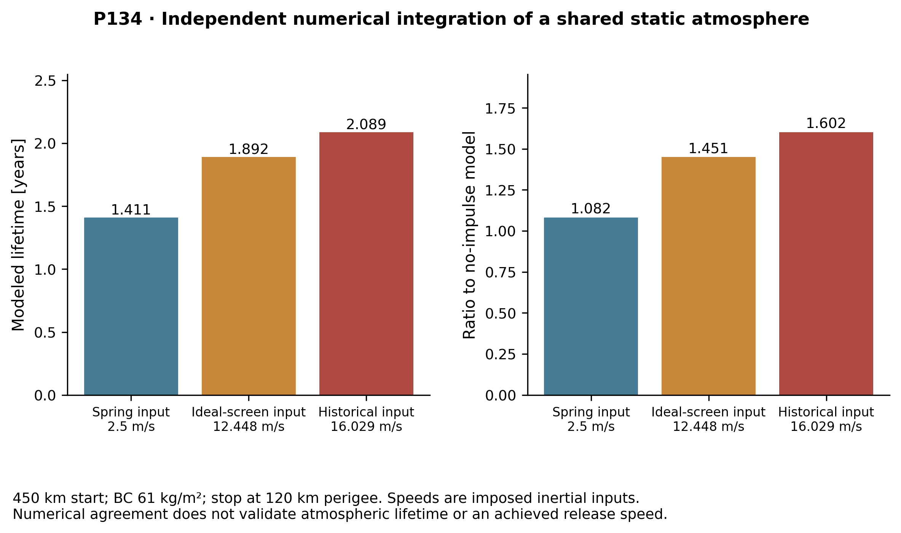

**Guide:** Vikas Gulia 
**Student PRNs:** Adityavardhan Mishra — 23070125054; Pratham Chawla — 23070125029 
**Department:** Mechanical Engineering, Symbiosis Institute of Technology 
**Document type:** Final-year project report; pre-submission review draft, not guide-approved or plagiarism-checked

# Reader's map and abbreviations

The abstract states the decision; Chapters 1–5 give the problem, prior art, objectives and method; Chapters 6–8 present the controlled Gen5 calculation and adverse findings; Chapters 9–10 give the conclusion and future Gen6 gates. Appendix A traces numerical and CAD claims to source files. Appendix B records the remaining technical closure. The repository PDF is self-contained for the principal results; linked scripts and logs are its reproducibility record.

| Term | Meaning |
|:--|:--|
| CAD / STEP | Computer-aided design / ISO 10303 exchange geometry |
| CG / ICD | Centre of gravity / interface control document |
| FEM / FEA | Finite-element method / finite-element analysis |
| J2 / LEO | Earth's second zonal gravity term / low Earth orbit |
| LSM | Linear synchronous motor |
| 1U / 3U | CubeSat form-factor classes; no specific spacecraft is qualified here |

**Figure provenance:** every rendered CAD view is a model visualization. Every graph is a calculation unless explicitly identified as external data. None depicts a VOLLEY hardware test. The figure captions and Appendix A identify the relevant model family; the final release must retain source paths and hashes.

\newpage

\tableofcontents

\newpage

\listoffigures

\newpage

> **Scope of this report.** VOLLEY is a system-level engineering design and computational research project. The Gen5 evaluated configuration and adverse numerical findings are documented; decisive force and mission closure remain open. The results are predictions, with numerical cross-checks where identified. Physical prototype testing, CubeSat qualification and provider accommodation belong to a later development phase. Gen6 is presented separately as future work.

{width=88%}

# Abstract

This final-year project report evaluates a magazine-fed electromagnetic CubeSat deployer as a *computational design study*. For a twelve-payload 3U configuration, the historical periodic-force model predicts a 16.029 m/s rated release at 10.068 g and 2.782 kJ gross shot draw. A finite-array/stator 3-D analytic integral challenges that speed prediction, giving 12.448 m/s under ideal phase. A separate 2-D finite-element screen gives 1.082 kJ ideal work; an independent numerical 3-D surface-charge formulation reproduces 1.042 kJ under shared assumptions. An illustrative 14 mm face gap lowers ideal work to 0.907 kJ, while a conditional full-winding bank rerun gives 2.099 kJ gross draw. These are model results, not a selected motor rating. An independent Cartesian two-body calculation reproduces a 28.800775 km immediate semi-major-axis rise for the rated 450 km case. A native FreeCAD 1.0 review document and STEP exports expose an 11 mm transverse shortfall in the specified side-fed layout, with 32,915 mm³ of exact-solid overlap per cassette. The estimated 126.6 kg dry mass gives 10.547 kg of deployer per carried 3U, failing both the 2 kg economic screen and an approximately 6 kg spring-canister parity comparison. Atmospheric lifetime, exact payload interfaces and full mission delivery remain conditional or open. There is no physical prototype or VOLLEY test data. The completed result is a documented model-based decision against this Gen5 3U configuration, with Gen6 scale-up treated as future research.

**Keywords:** CubeSat deployment; electromagnetic launcher; systems engineering; numerical verification; CAD interference; orbital mechanics; model credibility.

# Document control and evidence convention

| Item | Review baseline |
|:--|:--|
| Configuration | Gen5 twelve-3U side-fed reference; 1.5 m release station on 1.8 m structural longerons, 1.3 m powered stroke |
| Report status | Academic review draft; negative criteria retained |
| Evidence | Model outputs, selected independent numerical checks, native CAD import/export and prior literature |
| Exclusions | Hardware measurements, payload qualification, provider ICD approval, real-atmosphere lifetime validation |
| Build record | Reproduce PDF from this Markdown with Pandoc and XeLaTeX; inspect local source and run sheets |

This draft uses a conventional chapter structure. No unperformed test, approval or hardware validation is implied.

# Executive summary

VOLLEY investigates a last-mile problem in rideshare launches: a secondary CubeSat reaches orbit but ordinarily receives the orbit selected for the primary payload. A spring deployer separates it safely, often at roughly 1–2 m/s; that relative impulse, later drag differences, or host maneuvering can change its in-track phase. Deployment time by itself does not create persistent phase separation from an otherwise unchanged co-orbital host. A larger, deliberately commanded release velocity can also change orbital energy. The thesis evaluates whether that added capability justifies a complete deployer system. The mission model splits responsibilities between a maneuvering host, which performs coarse repositioning, and a deployer, which supplies each satellite's commanded release condition.

This report analyses one Gen5 solution: a magazine-fed, linear synchronous motor driving a reusable magnetic sled. The historical periodic-force 3U model predicts **16.0 m/s** exit speed at **10.07 g**. Its modeled dry-mass rollup is **126.6 kg**, and the power model predicts **2.782 kJ** gross electrical draw per shot. A closed-loop simulation predicts **0.0274 m/s ($3\sigma$)** exit-speed dispersion at a 15.8 m/s setpoint. In a stated orbital case, the assumed historical 16.029 m/s release input raises semi-major axis by **28.8 km**, with a **1.60×** modelled lifetime multiplier at mean solar activity. The lifetime result is atmosphere-sensitive and is numerically reproduced by P134 under a shared static atmosphere, not independently validated against the real environment.

Gen5 also produced a decisive negative result. With twelve 3U satellites, its deployer mass is **10.55 kg per customer**, versus about **6 kg** for the spring canister comparator used in the thesis. This is **1.76×** as much hardware per 3U payload and fails the preset 15% mass-parity band. The study therefore reaches a decision: the conditional modelled orbital benefit does not make this Gen5 configuration a defensible 3U selection. The result completes the analytical comparison; it does not require a prototype to know that the modelled mass criterion failed. Physical payload loads, magnetic cleanliness, cycle life, and provider interfaces remain questions for a different evidence phase.

The later Gen6 programme retains the hosted sequential-deployment mission while reopening mechanism choice. It investigates an approximately **1–2 m/s to 1 km/s** release-speed envelope across electromagnetic, mechanical, stored-energy, gas/fluid, hybrid and conventional options. The high end is a requirement to examine and may prove infeasible. The near-term goal is one named, reproducible, independently reviewable test-article configuration with a corresponding build/test release decision.

# 2. Finite-force, feeder-route and mission findings

The 16.029 m/s shot result assumes periodic thrust throughout a 1.3 m powered stroke. A new 3-D analytic integration of the exact cuboid field over the CAD's finite 162-belt stator finds **1.042 kJ ideal work**, corresponding to **12.448 m/s only under optimal phase with switching, voltage and friction losses omitted**. The modeled mover array and stator stop directly overlapping after 1.066 m travel. The 336 mm magnetic model and 340 mm CAD envelope also disagree. Cross-section quadrature refinement changes the three checked station forces by at most 0.369%; halving station spacing changes work by 0.096%. The magnetic field law is shared with the earlier model, so this is an adverse analytic screen, **not an independent 3-D FEM or a hardware test**. The historical 16.029 m/s remains in older tables for traceability and must not be called demonstrated performance. See [P118](../validation/P118_gen5_finite_force_map.md).

{width=96%}

A separate **2-D finite-element magnetostatic solve** of the finite magnet array gives **1.082 kJ ideal work** on its finest 1 mm mesh, compared with the 3-D analytic screen's 1.042 kJ. The 2-to-1 mm mesh change is 0.59%; a larger air boundary changes the 2 mm work by 0.0004%. The solver uses a different field formulation but omits magnet-depth end effects, so the two absolute results must not be combined into an achieved speed. [P119](../validation/P119_gen5_finite_force_fem2d.md) records meshes, convergence and assumptions.

{width=96%}

An independent **depth-resolved 3-D numerical surface-charge implementation** integrates all finite magnet faces and 162 belts. It returns **1.042 kJ ideal work**, agreeing with the analytic cuboid-field implementation under shared geometry, remanence and ideal-phase assumptions. Face quadrature refinement changes work by 0.00002%; halving station spacing changes it by 0.096%. This is a formulation cross-check, not 3-D FEM or hardware validation. An illustrative 14 mm face gap gives **0.907 kJ**, 13.0% below the 12 mm case. These deterministic cases are not fabrication tolerances. [P121](../validation/P121_gen5_finite_force_surface3d.md) and [P122](../validation/P122_gen5_finite_force_sensitivity.md) include source, results and convergence.

{width=96%}

A **conditional finite-force bank/trajectory rerun** retains the historical 96 V, 6 F, 12 mΩ source and assumed converter. With the full 1.3 m winding energized it computes **2.099 kJ gross capacitor draw** and 927 J copper heat; an illustrative 0.34 m active-copper branch gives 1.394 kJ gross and 243 J copper heat. Both report 12.448 m/s because the force curve is imposed at ideal phase; no voltage-limited switching law or selected winding/inverter exists. The old 2.782 kJ, brake and control outputs are not revised ratings. [P120](../validation/P120_gen5_finite_coupled_shot.md) gives the time history and energy ledger.

The [P125 conditional voltage/current screen](../validation/P125_gen5_voltage_limited_screen.md) adds a source-power check to the finite force map. Under the old, **unselected** 12 mΩ bank and periodic winding values, the quasi-steady reference still gives 12.448 m/s, while halving the phase-current limit gives 8.802 m/s. Under the older distributor-data 116–185 mΩ **single-string** ESR bound, the source-power quadratic fails at 0.612 m and 0.160 m respectively, before release. Ideal two- or three-parallel-string branches complete numerically only by multiplying capacitance, cell count and source mass. None is a manufacturer-rated, thermally checked switching design; the model assumes instantaneous q-axis current. The 12.448 m/s result must therefore not be presented as a sourceable release rating.

{width=96%}

An **unselected R1 geometry candidate** uses a 570 mm wide enclosure. Its native FreeCAD document and STEP parts clear the original cassette--track overlap and twelve scripted 3U envelope transfer paths against selected fixed parts. A subsequent all-leaf exact-solid audit finds five other intersecting pairs in this widened assembly, including sled--track and sled--stator conflicts. The reference track beam occupies the roller corridor because its solid model has no channel cut; the sled backstop occupies the stator proxy. R1 therefore does not pass complete assembly integration. It also lacks the actual lift/carriage, launch restraint, actuation, tolerances, fault recovery and revised installed mass. Its increased envelope has no approved host. This candidate does not alter the evaluated Gen5 configuration or repair the performance discrepancy. See [R1 CAD record](../cad/FEEDER_CANDIDATE_R1.md) and the [all-leaf audit](../cad/GEN5_FULL_INTERFERENCE_AUDIT_2026_10_12.md).

The separate [P126 lateral tolerance screen](../cad/FEEDER_R1_TOLERANCE_SCREEN.md) uses R1's CAD-derived 5 mm nominal cassette-to-track gap. With declared 1 mm track placement, 1 mm cassette placement, 0.5 mm combined form and 0.2° angular error across a 340.5 mm payload proxy, worst-case residual is 1.31 mm; a 0.5° band overlaps by 0.47 mm. These are illustrative assumptions, not measured process capability or released GD&T.

[P127 conservation bounds](../validation/P127_gen5_release_arrest_bounds.md) put 731.8 J of kinetic energy into the modeled 9.445 kg sled at the **ideal** finite-force speed. Across the provisional CAD brake's 210 mm length, stopping requires at least 37.6 g mean sled deceleration. Eddy-current peak force, repeated-shot heat, payload contact and host attitude remain unsolved; the mean bound is not a brake acceptance test.

{width=90%}

A **matched reference comparison** uses twelve identical 4 kg payloads at 450 km, the same 300 kg base host with 10 kg assumed fuel and 220 s specific impulse, and installed device masses of 72 kg for a spring class versus 126.562 kg modeled Gen5. To meet one common +16.029 m/s inertial payload target at the same epoch, ideal host preburn takes 2.693 kg of propellant with 2.5 m/s spring release and 0.827 kg with the 12.448 m/s finite Gen5 estimate. The subsequent common-input, assumed-100 N twelve-shot optimizer accepts prefixes of **4/12 spring, 1/12 finite Gen5, 1/12 historical Gen5**. None closes. These are bounded numerical cases, not a supplier quote, proof of infeasibility or product advantage. Onboard propulsion, transport services and long-horizon drag remain unmodeled. See [matched mission inputs](../docs/MATCHED_MISSION_REFERENCE.md).

{width=96%}

## What a precision-delivery product would have to prove

The economic case is a **delivered orbital state at a specified epoch and tolerance**, not a high release speed by itself. [P123's reproducible one-event mass screen](../validation/P123_gen5_one_event_mass_screen.md) finds that, with the same assumed host and 10 kg initial fuel, an ideal finite-force Gen5 release saves 1.866 kg of host propellant relative to a 2.5 m/s spring release. Its modeled hardware is 54.562 kg heavier. If fuel is resized to the one event plus the same 2 kg reserve, Gen5 still carries 52.717 kg more device plus fuel. Even a hypothetical zero-burn release needs a device at or below 74.659 kg to tie this specific spring reference. This is a serious architecture requirement, although it is not a full twelve-shot economic result or a price for a tailored orbital state.

[P124's independent orbit and stroke screen](../validation/P124_precision_delivery_design_space.md) works backward from ideal orbit targets. At 450 km circular altitude, a 20 km immediate semi-major-axis rise requires about 11.149 m/s of *inertial tangential* increment. A ±0.1 km axis band leaves roughly 0.0555 m/s on its smaller side **if every other error is zero**. A flight requirement must divide the error among host state, release direction and speed, timing, orbit propagation and tracking, and must include along-track, plane and disposal constraints. The old 0.0274 m/s modeled release dispersion is unmeasured and cannot be applied to P118's challenged finite-stator case.

Over the evaluated 1.3 m powered stroke, an ideal 10 g constant-acceleration limit allows 15.97 m/s. At 1 km/s, the same stroke implies roughly 39,220 g and 2 MJ of payload kinetic energy for a 4 kg 3U; a 10 g stroke would be about 5.10 km. This makes the 1 km/s objective unsuitable as the specification for a first ordinary-3U Gen6 prototype. The first test article should instead inherit a **named mission, payload load limit and host interface**, and select a lower-speed command range only after a matched service comparison. This preserves the longer-range research goal while making prototype tests technically meaningful.

{width=95%}

# 1. Introduction

## The deployment problem

The primary mission determines the launch vehicle's delivered orbit. Secondary CubeSats may have limited onboard propulsion, mass, power, or programmatic freedom to correct that orbit. Standard canisterised spring systems are mature and effective at clearance and separation. Their release conditions, however, are governed by spring energy, payload mass, and the device rather than a separately commanded velocity profile for every satellite.

The distinction between **release timing** and **relative-state change** is central. Waiting alone between zero-relative-impulse releases from an unchanged host does not produce persistent in-track phase spacing. Spring impulse, differential drag or a host maneuver can produce a relative state; a commanded velocity along or against orbital motion can change the satellite's orbital energy and semi-major axis. VOLLEY studies the latter capability while retaining a clear comparison with spring release and other alternatives. It does not claim that all constellation phasing requires a motor.

The host is an active participant in the mission model. After its primary mission, a suitable hosted platform would need attitude control, available resources and permission to operate. It could perform coarse orbital repositioning; VOLLEY would assign each secondary payload a local release state. No specific upper stage has been selected or approved for that role.

## Buyer and spacecraft fit

The [audited market and customer-fit report](../MARKET_AND_CUSTOMER_FIT.md) checks the relevant Drive market thesis and independent business-case review against current primary sources. [Planet's FY2026 filing](https://www.sec.gov/Archives/edgar/data/1836833/000119312526119957/pl-20260131.htm) and [Spire's 2025 filing](https://www.sec.gov/Archives/edgar/data/1816017/000119312526116169/spir-20251231.htm) show repeatable, configurable smallsat production. [NASA's 2026 launch review](https://www.nasa.gov/smallsat-institute/sst-soa/integration-launch-and-deployment/) confirms that a primary mission can constrain the orbit available to rideshare payloads. Together, these support a *mission hypothesis*, not customer demand.

The likely party that could pay for individualized release states is a carrier, rideshare integrator or constellation operator responsible for a delivered manifest. A standardized satellite-bus maker may specify interfaces but need not buy the system. Replenishment batches and mixed-payload rideshare are candidate jobs. A one-satellite mission already in a suitable orbit is a poor fit and should favor a qualified conventional dispenser. The analyzed Gen5 system carries twelve 3U spacecraft but fails its own 3U mass screen; a PocketQube batch is a **future interface redesign**, not an accommodated or qualified Gen5 payload class. Payloads sensitive to magnetic fields need an explicit exclusion or design remedy. No buyer, payload or provider has confirmed these requirements.

For an economic result, price and simulate the same manifest delivered with ordinary spring impulse, spring plus host manoeuvres, onboard propulsion, an orbital-transport service and VOLLEY. The published [SpaceX rideshare starting price](https://new.spacex.com/rideshare) cannot stand in for an installed VOLLEY cost or savings quote. A three-to-five-year replacement cycle and a 5–50 m/s release range are research hypotheses from the Drive market report, not Gen5 operating requirements or established market demand. The Gen6 1 km/s upper objective is a different, unvalidated regime.

{width=100%}

# 2. Literature review

| Approach | Established capability | Relevance and limit |
|:--|:--|:--|
| Spring deployers | Flight heritage and simple separation near the low-m/s range [1] | Strong benchmark for reliability and installed mass; release energy is largely built into the device. |
| Spring release and differential drag | In-track spacing and gradual orbital adjustment [3] | A relative impulse or drag difference creates the separation; waiting alone from an unchanged co-orbital host does not. |
| Orbital transfer vehicles | Coarse orbital repositioning through a propulsive carrier | Valuable comparator for whole-mission delivery; greater spacecraft and integration burden must be counted. |
| Electromagnetic CubeSat studies | Magazine transport and electromagnetic launch have already been studied [4–6] | Some configurations impose conductive armatures, high acceleration or different maturity; novelty cannot be claimed for electromagnetic deployment alone. |

The most relevant high-speed electromagnetic comparison in the manuscript is Feng *et al.* [4], which models a 321.56 m/s launch of a 20 kg CubeSat but at acceleration on the order of thousands of g and with an armature/interface issue. Zhao *et al.* [5,6] study stacked CubeSat transfer and storage, including measured transport behavior in a related mechanism. These works establish that electromagnetic delivery and magazine transport are prior art. VOLLEY's more limited question is whether a **commandable** release can be delivered to an **unmodified** satellite at a much lower acceleration while accounting for the whole installed system. No universal CubeSat quasi-static acceleration qualification is assumed; the launch provider and payload-specific limits must govern a real design [2,8].

# 3. Research gap

The analytical gap is not “no one has considered electromagnetic deployment.” It is the coupled trade between: (i) commanded release, (ii) payload-side interface and acceleration, (iii) a reusable feed/release architecture, (iv) host reaction and mission utility, and (v) installed system mass and faults. A speed-only comparison can make a concept appear attractive while omitting its sled, power bank, brake, magazine, enclosure, control, and retained mass after each shot.

The thesis addresses that gap by constructing a documented Gen5 reference configuration and testing its own claims against explicit comparisons. It also records when those tests weaken the concept. Physical viability remains a separate research gap: numerical model agreement cannot establish manufactured tolerances, actual force, payload cleanliness, cycle reliability or provider compatibility.

# 4. Objectives and outcome

| Analytical research objective | Completed outcome | Interpretation |
|:--|:--|:--|
| Model a commandable 3U system | Reference CAD, magazine concept, sled, motor, arrest and power architecture | Feed and release mechanics remain unresolved |
| Quantify the release | Historical periodic shot, circuit and closed-loop simulations; adverse finite-force screen | No selected or verified speed rating |
| Evaluate orbital value | Historical-input orbit model and selected numerical cross-checks | Conditional geometry; rated lifetime remains open |
| Test whole-system competitiveness | Mass rollup, spring/alternatives comparison and preset criteria | Gen5 fails the 3U mass target |
| Challenge model credibility | Numerical verification, defect corrections and provenance record | Scope and remaining physical uncertainties made explicit |

These objectives summarize the completed analytical research for this final-review presentation. They are a presentation synthesis, not a claim that the university approved this exact list in advance. The physical development tasks are shown later under future work.

# 5. Research methodology

The project follows an engineering evidence chain:

1. **Mission/use-case framing:** specify the payload, host responsibilities, target orbital change, safety limits and competent conventional comparators.
2. **Architecture trade:** examine force production, loading, restraint, guidance, arrest, reset and fault behavior, rather than only ideal acceleration.
3. **Geometry and installed mass:** build CAD geometry and count the sled, arrays, enclosure, feed, power, controls and other installed parts.
4. **Coupled models:** compute magnetic field and thrust, shot dynamics, power/circuit behavior, control dispersion, structural/flow responses and orbital consequences.
5. **Challenge the claims:** use alternate numerical methods and acceptance bands, preserve misses and update the baseline only with a recorded reason.
6. **Decision:** compare orbital benefit against mass, reliability, payload/host compatibility and the available alternatives.

## Controlled question and acceptance logic

The evaluated configuration is the twelve-3U, side-fed Gen5 reference. Its mission and mechanical claims cannot be transferred to the later R1 enclosure or Gen6 first-article candidates without new analyses. The study asks whether this reference yields a credible commandable release and an installed advantage while fitting its stated geometry. A failed criterion is a completed result of that question; it is not a validated deployer.

| Decision question | Test and evidence | Acceptance interpretation |
|:--|:--|:--|
| Can the specified side-fed parts coexist? | Native FreeCAD/STEP exact-solid checks and width arithmetic ([P116](../validation/P116_gen5_assembly_packaging.md)) | Nonintersection and positive service clearance required; reference **fails** before tolerance stack |
| Does the historical 3U speed survive finite force geometry? | Periodic model versus finite 3-D integral, independent formulation and 2-D FEM ([P118](../validation/P118_gen5_finite_force_map.md), [P119](../validation/P119_gen5_finite_force_fem2d.md), [P121](../validation/P121_gen5_finite_force_surface3d.md)) | Historical 16.029 m/s is challenged; 12.448 m/s is an ideal screen, not a rated pass |
| Can a source supply the assumed shot? | Conditional voltage/current and bank cases ([P120](../validation/P120_gen5_finite_coupled_shot.md), [P125](../validation/P125_gen5_voltage_limited_screen.md)) | No selected source or inverter; one commercial single-string ESR case **fails** |
| Does installed mass meet the predeclared 3U criterion? | Component rollup, 12-customer division and 15% parity band ([P117](../validation/P117_rated_energy_mass_audit.md), [P123](../validation/P123_gen5_one_event_mass_screen.md)) | 10.55 kg/3U exceeds the approximately 6 kg comparator and 6.9 kg allowed band; **fails** |
| Does the release yield mission value? | Historical-input orbit check and [matched host/payload comparison](../docs/MATCHED_MISSION_REFERENCE.md) ([P115](../validation/P115_rated_orbit_cartesian.md)) | Immediate semimajor-axis result is conditional; no twelve-shot matched campaign closes |

## Reproducibility and uncertainty rule

Each quantitative result must retain its input configuration, model method, software/source file, output file, comparison band and stated limits. A second implementation under the same geometry is a useful **numerical cross-check**, but shared material laws and boundary assumptions remain common-mode uncertainty. Mesh or quadrature convergence establishes discretization behavior within a model; it cannot establish physical accuracy. Supplier ratings, fabrication tolerance distributions, payload limits and host ICD limits are absent. Deterministic gap, current and bank sweeps therefore show sensitivity, not measured statistical confidence intervals. The open issues in Appendix A are held as exceptions rather than treated as zeros.

{width=100%}

## Numerical checks and their limits

The magnetic field was compared across an analytical representation, magpylib, and 2-D/3-D finite-element calculations. A 3-D midgap FEM solve supports the field model at its tested location; P121 separately checks the ideal depth-integrated thrust by numerical surface-charge integration. Neither is a motor measurement. Shot and circuit predictions were compared with ngspice at stated assumptions. Structural calculations use CalculiX; airflow calculations use OpenFOAM. Orbital calculations include Cowell and GMAT cases. The independent orbit work rejected an earlier assertion that lifetime benefit was invariant across solar activity. Each check applies to its declared case and boundary conditions; none is a hardware test.

{width=83%}

# 6. Timeline

## Documented evolution

| Period | Milestone | Confidence in date |
|:--|:--|:--|
| 2023 | Free-flyer idea reframed around a host platform | Documented design decision |
| Mid-2025 | Coilgun concept shifted toward a linear synchronous motor | Approximate historical milestone |
| 2025–July 2026 | CAD generations and mass model developed | Some dates reconstructed/approximate |
| July–September 2026 | Gen5 analysis, numerical checks, defects and thesis record | Dated repository/analysis records |
| October 2026 | Gen5 findings and design decision assembled for academic review; final presentation scheduled for 31 October | Review package dated 10 October |

The thesis repository's reconstructed history expressly marks several early milestone dates as approximate. The analytical baseline was revised as evidence improved: a CAD-derived sled mass displaced a lighter parametric estimate; a depth-resolved thrust calculation lowered the rated speed; an enclosure buildup exposed the 3U mass penalty; and an independent orbit check rejected an overbroad solar-invariance claim. These revisions are part of the review record; the historical 16.029 m/s shot remains traceable, but no final speed rating is selected. Gen6 research gates are described only in §10, Future work.

# 7. Work progress

The thesis deliverables are in hand: an authored manuscript, CAD renders and model geometry, analysis scripts/results, numerical verification run sheets, figures, a baseline record, a defect register, and a provenance statement. Numerical investigations cover the motor field, shot dynamics, bank/circuit, mass, orbit propagation, separation and selected structural, airflow and reliability issues. The study closes by retaining failed criteria and superseded results rather than silently replacing them.

The deliverable here is a documented computational feasibility study with adverse findings, not a flight article or an engineering release. The later long gas-guide and independent spring-cell studies are historical comparators. Gen6 has a mission direction and investigation envelope but is not a result of the Gen5 thesis. Its mechanism and exact payload/provider cases remain future choices.

# 8. Results

## Calculation identities and units

The following simple identities are independently inspectable checks on the report's headline arithmetic. They do not verify the magnetic field, power-electronics operation or the mission model.

| Check | Calculation | Meaning |
|:--|:--|:--|
| Reference cassette width | 205 mm track + 2 × 166 mm cassettes = **537 mm**; 537 − 526 = **11 mm** | Static width shortfall before clearance and tolerance |
| Hardware mass per 3U | 126.562 kg ÷ 12 = **10.547 kg** | Modeled dry hardware allocated across twelve 3U customers |
| Allowed mass under the stated parity band | 6 kg × 1.15 = **6.9 kg per 3U**, or 82.8 kg for twelve | Comparator is approximate; the modeled 126.562 kg misses by roughly 43.8 kg |
| Historical payload kinetic energy | ½ × 4 kg × (16.029 m/s)² ≈ **514 J** | Arithmetic check of the historical shot energy ledger, not a demonstrated speed |
| Finite-force ideal moving energy | ½ × (9.445 + 4) kg × (12.448 m/s)² ≈ **1.042 kJ** | Agrees with ideal work when losses are excluded; a physical drive would need more input |

The ideal finite-force number is deliberately not substituted for the historical circuit and control outputs. The 1.042 kJ model work, the 2.099 kJ conditional full-winding capacitor draw, and the older 2.782 kJ gross draw describe different assumption sets. They are not three measurements of the same installed system.

## Gen5 configuration

The analysed system uses a double-sided Halbach-array linear synchronous motor to propel a reusable permanent-magnet sled to a release station 1.5 m from the breech on 1.8 m structural longerons. Two transverse cassettes are intended to feed twelve 3U satellites, but the present side-fed placement fails the fit check. A capacitor-based bank supplies the modeled pulse, and a brake is intended to arrest the sled after payload release. The **9.45 kg** sled input comes from historical Gen3 CAD solid volumes; this value reduced the exit speed relative to an earlier optimistic parametric estimate. The CAD render conveys a concept, not manufactured or assembled hardware.

## Historical periodic-model 3U shot

The table below preserves the older model run for traceability. Its constant periodic-force input is challenged by the finite-geometry screen above. These numbers cannot be promoted together as the current machine's demonstrated or independently verified operating point.

| Model output | Historical result | Interpretation |
|:--|--:|:--|
| Exit velocity | 16.029 m/s | Historical periodic-force input; finite geometry challenges it |
| Payload acceleration | 10.07 g | Not a payload qualification claim |
| Pulse duration | 162.3 ms | Modelled motor actuation |
| Peak current | 320 A | Component implementation unverified |
| Electrical energy drawn, gross | 2,782 J | Bank/circuit model |
| Recovered after release | 47 J | 39 mm available recovery zone |
| Sled energy to brake | 1,162 J | Major loss and arrest burden |
| Electrical-to-payload efficiency, net | 18.8% | 514 J payload kinetic energy / net draw |

The energy flow matters more than the velocity headline. The sled and its arrest hardware are part of the modeled price of avoiding a payload-side drive armature. Regeneration returns only a small fraction of sled energy within the available length. [P117](../validation/P117_rated_energy_mass_audit.md) separately checks the reported mass and energy identities and reconciles the historical **124.488 J (4.47%) compact-output remainder** to 90.964 J assumed converter loss, 32.460 J auxiliary draw and 1.064 J of forward-Euler step excess, with a rounded residual below 0.001 J. This closes historical model arithmetic only. Selected hardware, switching and installed power verification remain open.

## Command precision

The closed-loop Monte Carlo model predicts **0.0274 m/s ($3\sigma$)** exit-velocity dispersion around a **15.8 m/s** fleet setpoint. It uses assumed sensing and plant tolerances, with headroom below the open-loop ceiling. This is a simulated distribution, not a measured release repeatability.

{width=84%}

## Orbital utility

For the stated orbit and mean-solar-activity case, an **assumed historical 16.029 m/s release** predicts a **28.8 km** semi-major-axis increase and a **1.60×** lifetime multiplier for a propulsionless satellite. A separate Cartesian two-body integration of that assumed historical release state returns **28.800775 km**, agreeing within the declared numerical band. This checks only the immediate orbital-energy result. P134 independently integrates the shared static-atmosphere model and gives a 1.602165 ratio; that numerical agreement does not validate real lifetime or solar invariance. Timing alone, with zero relative impulse and no host or drag difference, produces neither persistent phasing nor this semi-major-axis change.

{width=92%}

{width=87%}

## Installed mass changes the decision

The modeled Gen5 dry rollup is **126.6 kg** and loaded mass **174.6 kg**; these include assumed hardware and historical Gen3 sled volume, not a mass extraction from a complete installed Gen5 assembly. At twelve 3U customers, the deployer weighs **10.55 kg per customer**, compared with approximately **6 kg** for the spring canister comparator used in the analysis. The ratio is **1.758**; the preset acceptance band required parity within 15%. That band fails by a large margin. Replacing an **8 kg enclosure placeholder** with a **50.04 kg** geometry-derived buildup exposed much of the penalty. Even changing structure alone does not recover parity in the studied options. The result is a reason to reopen the architecture, not to conceal the comparison.

{width=100%}

## Native CAD and packaging review

The geometry package now includes a FreeCAD 1.0 native document, eight re-exported STEP parts, and a 20-instance STEP assembly. Each imported solid passed FreeCAD validity and nonzero-volume checks. The source solids were produced in CadQuery; importing them into FreeCAD does not create parametric feature history or prove that the assembly can be manufactured. The [CAD review report](../cad/GEN5_CAD_REVIEW.pdf) identifies source revisions and checks, while [P116](../validation/P116_gen5_assembly_packaging.md) records the numerical intersection result.

The side-fed reference assembly has **526 mm** clear enclosure width. Its **205 mm** track plus two **166 mm** cassettes require **537 mm**, an **11 mm** shortfall even before running clearance. The exact solids overlap by **32,915 mm³ per side** in this placement. A full census of the 20 leaf solids finds **17 intersecting pairs**. In the reference placement, the sled intersects the track by **82,983 mm³** and stator by **6,300 mm³**. The interface-ring proxy also intersects track, stator and enclosure proxies; stored-payload boxes intersect cassette bodies. Proxy contact and physical collision require separate engineering disposition, but the sled/track and sled/stator conflicts prevent acceptance of the assembly as drawn. The scripted feeder-path check did not evaluate these pairs. A different feed architecture, enclosure or dimension set requires a new configuration and reassessment; the current render must not be presented as an assembled flight article. The [all-leaf audit](../cad/GEN5_FULL_INTERFERENCE_AUDIT_2026_10_12.md) supplies the pair inventory and source script.

{width=92%}

## Decision and evidence boundary

The analytical result has four parts. The historical model represents a proposed commandable release and a conditional orbital-energy benefit, but its speed is challenged by finite geometry; the full-system 3U mass criterion fails; the stated side-fed layout fails its CAD width check; and physical behavior remains unverified. The latter includes release-cycle reliability, shock and arrest loads transmitted to stowed satellites, field exposure near a customer payload, host attitude/control authority and provider approval. The known-problems register ranks several as potentially design-fatal. These findings limit product claims and define the research conclusion.

## Verification status and unresolved physical behavior

| Area | Evidence in this study | Limit that must be carried into the decision |
|:--|:--|:--|
| Magnetic force | Finite analytic calculation, separate surface-charge formulation, 2-D FEM mesh check | No selected winding/inverter, transient 3-D electromagnetic solve or measured thrust |
| Drive and source | Conditional bank and voltage/current cases; adverse single-string ESR case | Component ratings, switching, bus impedance and repeated-shot thermal closure absent |
| Geometry | Native solids, STEP export and exact-solid intersection checks | The evaluated side-fed reference fails; R1 is unselected and its tolerance screen is illustrative |
| Feed, restraint and release | Intended path and partial envelope review | No modeled actuator, contact, latch, jam recovery, tip-off or reset sequence |
| Arrest and host loads | Energy/momentum conservation bounds [P127] | No rated brake force, repeated heat, satellite shock or host attitude response |
| Orbit and mission | Independent two-body immediate-axis check; matched surrogate comparison | Exact atmospheric lifetime and a completed twelve-shot mission are unverified |
| Payload/provider accommodation | Public form-factor and standard references | No named Gen5 spacecraft, host/provider ICD or acceptance limits |
| Physical verification | None | No prototype, measured shot, environmental test or flight qualification |

These limitations are part of the research result. A software demonstration can show reproducibility of the computations, but it cannot establish the reliability of a mechanical feeder or release on orbit.

# 9. Conclusion

The Gen5 computational thesis reaches a research conclusion within its stated scope. Its historical model predicts a moderate-acceleration release, but finite geometry challenges the speed; an independent two-body calculation checks only the immediate orbital change under that assumed release state. Installed-mass accounting misses its preset 3U benchmark, and the side-fed reference CAD assembly fails its width check. The current configuration is therefore not a selected flight baseline. Hardware behavior and interfaces remain outside the tested evidence.

The thesis's strongest engineering contribution is the transparent decision record: system budgets and idealized mechanisms were modelled, independent numerical checks corrected several claims, and an unfavourable mass result was retained. That closes the Gen5 study and provides a defensible input to a separate future architecture trade.

# 10. Future work

Gen6's controlling objective is a reusable launch path that sequentially accepts different supported CubeSat sizes and commands each departure condition. The approximately 1–2 m/s to 1 km/s span is an investigation envelope; the upper end may force acceleration, energy, travel, payload or provider constraints that reject candidates. Electromagnetic systems are preferred for comparison but are not preselected. Competent springs, electromechanical/stored-energy, gas/fluid, hybrid and conventional mission substitutes belong in the same comparison boundary.

The near-term milestone is one named test-article configuration that can be independently reviewed. Its package needs controlled geometry and drawings, a bill of materials, host and payload interfaces, full installed mass/energy/thermal accounting, assembly and inspection instructions, instrumented procedures, predetermined pass/fail and stop criteria, uncertainty and model-credibility evidence, retained failures, and an explicit build/test release decision. A rejected candidate is a valid research outcome; it must not be presented as a build-ready survivor.

## Post-study Gen6 service and first-article screens (P130–P132)

The follow-on mission is an explicitly **surrogate** four-release case: two passive 1U and two passive 3U spacecraft, a roughly 500 km sun-synchronous host, all releases within one orbit, and a distinct full position/velocity target for each satellite 24 hours after the last release. The [matched J2 campaign](../validation/P130_gen6_matched_campaign.md) lets both commanded release and spring plus host maneuvers meet the **same** four exact mathematical targets. With assumed installed masses of 30 kg for VOLLEY and 16 kg for springs, VOLLEY saves 3.2823 kg of host fuel but adds 14 kg of installed device, leaving a 10.7177 kg penalty on the narrow device-plus-consumed-fuel measure. A +0.1 m/s release-speed perturbation moves the one-day terminal position by roughly 25–27 km in either strategy. Exact numerical matching is not delivered-state accuracy; the study has no customer tolerance, navigation covariance or physical dispenser rating.

Two editable [FreeCAD/STEP 3U first-article envelope candidates](../cad/gen6_first_article/README.md) provide a separate geometry screen. A captured permanent-magnet carrier is the analysis lead; a captured conductive-plate carrier remains a challenger. Their **partial** frame, guide and carrier material proxies are 9.926 and 9.945 kg. Under the surrogate P130 mission, only about 9.35 kg remains for all unmodelled hardware before device-plus-consumed-fuel parity is lost. Five nominal positions have no solid intersection, but the assumed 0.7° yaw with a 1.5 mm linear stack clashes with the simple guide corridor. [P131](../validation/P131_gen6_go2_article_bounds.md) gives an ideal 6 m/s moving-energy floor of about 82 J. At an assumed 10% wall-to-kinetic efficiency, [P132](../validation/P132_gen6_go2_power_instrument_screen.md) requires at least 818 J of input; it does not select a source, motor or brake. The proposed first article's 3–6 m/s measurement band also does not cover the campaign's approximately 7 and 9 m/s hypothetical release commands.

A separate [one-cell fixed-cassette feeder study](../cad/gen6_feeder/README.md) begins the transfer design with one inert 3U envelope and a captive lead-screw pusher as an analysis reference. Four editable FreeCAD states and STEP exports depict stowed, armed, midway and seated positions. Its 81-station nominal B-rep transfer sweep over 200 mm has no internal feeder-solid intersection; that check did **not** include the first-article track and carrier. A later cross-assembly audit found a **34,050 mm³** transfer-bridge/guide overlap and a **74,910 mm³** mid-transfer payload/guide overlap. An unselected integration revision clears exact-solid overlap in four STEP states and 81 sampled transfer stations by lifting a guide window, shortening stop proxies and removing duplicate study solids. R1 leaves a **10 mm unsupported handoff gap**. A separately saved [R2 bridge revision](../cad/gen6_integration_r2/README.md) meets the support lip in sampled nominal states, with four STEP states and 81 sampled transfer stations again showing no exact-solid penetration. The bridge-extension/guide-lift sequence, continuous swept volume, contact load, tolerance and power-off restraint remain unverified. Under *assumed*, not manufacturing, perturbations, the earlier feeder-only interval screen leaves 3.5 mm side and 2.5 mm end-stop clearance. The [state/fault analysis](../cad/gen6_feeder/cycle_and_faults.md) finds a decisive unresolved condition: a payload partway between cassette and cradle lacks a demonstrated positive restraint after power loss. Neither the pusher actuator nor launch locks, contact loads, jam recovery or a working four-cell 1U/3U feed mechanism is selected. The [integration audit](../cad/GEN6_INTEGRATION_AUDIT_2026_10_12.md) records the boundary of the new check. A 6U cell is a later expansion. These follow-on files do not change the Gen5 result or establish P-POD-like reliability.

The subsequent [four-cell R0 study](../cad/gen6_four_cell_r0/README.md) positions two 1U and two 3U inert envelopes in staggered and paired fixed cells. Each unselected layout has 13 editable FreeCAD and STEP states with zero represented nominal solid penetration; four lateral transfer paths and a stowed-carrier docking path were sampled separately. In the staggered layout the final cell has only 330 mm of modeled acceleration path before the brake boundary, requiring 5.56 g *ideal mean* acceleration for 6 m/s. Paired sides give every cell at least 900 mm, reducing that largest ideal mean value to 2.04 g, without changing the 1,800 mm rail. Both layouts span 560 mm laterally before host mounting or access. These are geometry and kinematic screens, not proof of achievable speed, safe contact, power-off retention, carrier docking accuracy or host compatibility.

{width=94%}

{width=94%}

{width=92%}

The [provisional seven-concept weighted screen](../cad/gen6_feeder/WEIGHTED_TRADE_SCREEN_2026_10_12.md) applies the selected 35/25/20/10/10 weights for fault safety, fit/mass, positioning, cycle/power and manufacture. A captive lead screw ranks first as an **analysis reference** at 3.650/5; varying each unmeasured ordinal criterion by one point gives 2.650–4.650. That interval overlaps the spring-follower and rack-pawl alternatives. None has passed the mechanism-level four-cell, power-off-restraint, load or installed-resource gates, so the result does not select a feed mechanism. Alternative concepts remain in the laboratory archive for comparison.

{width=94%}

These screens make the next research questions specific, while preserving Gen5 as the sole evaluated thesis configuration. They do **not** close Gen6's mission value, full installed mass, moving-contact/release design, electrical and thermal ratings, qualification or build authorization. The [claim and gate disposition](../GO3_ACADEMIC_RELEASE_REVIEW.md) traces the open items for examination.

{width=88%}

{width=88%}

# 11. References and project records

1. JAXA, *JEM Payload Accommodation Handbook*, Vol. 8, small-satellite deployment interface control document, cited in the VOLLEY thesis.
2. California Polytechnic State University, *CubeSat Design Specification*, Rev. 14, 2020.
3. C. Foster *et al.*, “Constellation phasing with differential drag on Planet Labs satellites,” *Journal of Spacecraft and Rockets*, 55(2), 2018.
4. H. Feng, Y. Yang and Y. Wu, “Design and reachable domain analysis of on-orbit electromagnetic launcher for CubeSats,” *International Journal of Aerospace Engineering*, art. 3000765, 2025.
5. Y. Zhao *et al.*, “Design and analysis of a new deployer for the in-orbit release of multiple stacked CubeSats,” *Remote Sensing*, 14(17), 4205, 2022.
6. Y. Zhao *et al.*, “Simulation analysis and experimental verification of the transport characteristics of a high-volume CubeSat storage device,” *Aerospace*, 12(6), 466, 2025.
7. K. Halbach, “Design of permanent multipole magnets with oriented rare earth cobalt material,” *Nuclear Instruments and Methods*, 169, 1980.
8. NASA, *General Environmental Verification Standard*, GSFC-STD-7000A, 2013.
9. D. A. Vallado, *Fundamentals of Astrodynamics and Applications*, 4th ed., 2013.
10. A. Mishra, *VOLLEY-thesis*: authored manuscript, baseline, provenance, figures and validation records, repository head `b30ffdc`, 28 September 2026. Project record, not independent experimental evidence.
11. VOLLEY, *Gen6 G0 Mission and Article Requirements*, 12 October 2026. Reference study requirements, not achieved performance.

# Appendix A. Numerical and CAD audit trail

| Result | Reproducible record | What remains outside the check |
|:--|:--|:--|
| Rated shot and energy | [`analysis/results/motor_results.json`](../analysis/results/motor_results.json), [`analysis/motor_model.py`](../analysis/motor_model.py) | Unmeasured force and actual circuit parasitics |
| Rated immediate orbital change | [`P115`](../validation/P115_rated_orbit_cartesian.md), [`rated_orbit_independent.py`](../analysis/rated_orbit_independent.py) | Atmospheric lifetime and controlled host mission |
| 3U mass decision | [`mass_properties.json`](../analysis/results/mass_properties.json), [`BASELINE`](../appendix/BASELINE.md) | Hardware weighing, complete installed host burden |
| Native geometry and collision | [`Gen5_Review.FCStd`](../cad/native/Gen5_Review.FCStd), [`FREECAD_EXPORT.json`](../cad/FREECAD_EXPORT.json), [`P116`](../validation/P116_gen5_assembly_packaging.md) | Tolerance, feed motion, payload accommodation and provider fit |
| Wider model and open gates | [`computational review`](../reports/GEN5_COMPUTATIONAL_REVIEW.pdf), [`CAD review`](../cad/GEN5_CAD_REVIEW.pdf), [`open problems`](../appendix/OPEN_PROBLEMS.md) | Final verification closure and physical development |

The run sheets report software, inputs, declared comparison bands and files. Figures are generated model or CAD visualizations. A screenshot of a solver interface would not by itself establish a correct result; the editable model, data and case boundary are the audit trail.

# Appendix B. Technical closure status

Gen5 is a computational study with recorded adverse findings. Its evaluated configuration is not a qualified deployer or released product. The decisive electromagnetic, feed/release, brake, host, structural and installed-system questions remain open or bounded as recorded in the validation files. Physical bench and qualification tests are future work and remain marked unrun.

| System question | What this study actually establishes | Final Gen5 decision boundary |
|:--|:--|:--|
| Motor and electrical source | Historical 16.029 m/s periodic-model shot; finite-geometry ideal-phase screen 12.448 m/s; historical gross/net shot energy reconciled algebraically in P117 | **No component-rated release speed.** Winding, switching, source impedance, derating and coupled repeated-shot performance are unselected. The historical value is a model output, not a flight command. |
| Shot and brake heat | P117 identifies modeled copper, bank, converter and auxiliary terms; P127 puts 731.8 J into one ideal sled arrest and 8.782 kJ across twelve identical events before recovery/cooling | Heat deposition, peak temperature, duty interval, material limits, source warming and brake cooling are **unverified**. The twelve-shot sum is an energy bound, not a thermal qualification. |
| Magazine feed and release contact | The evaluated cassette placement fails by 11 mm; R1 gives a separate scripted path; tip-off calculations are model studies | No selected Gen5 feed actuator, launch restraint, contact law, tip-off acceptance or recontact test exists. No verified release-quality or P-POD-class reliability claim is made. |
| Carrier arrest and return | P127 gives a 3.485 kN *mean* braking-force floor over the provisional 210 mm corridor at the ideal 12.448 m/s screen | Peak force, brake heating, carrier containment, safe stop, reset, jam and abort behavior are **unverified**. Mean deceleration does not prove peak deceleration. |
| Structure and environment | Preliminary structural and geometry studies identify loads and the side-fed clash | No same-revision launch-load, vibration, shock, thermal-distortion or converged structural acceptance is claimed. |
| Magnetic/payload compatibility | Field studies identify exposure concerns, including possible magnetometer saturation | A passive spacecraft is only a surrogate envelope. Payload magnetic limits, shielding, safe standoff and provider approval are **unknown**. |
| Orbit and campaign | Independent Cartesian two-body calculation checks only the immediate 28.800775 km axis change *if* the historical 16.029 m/s departure state is imposed; sampled twelve-shot cases do not close | The 1.60× lifetime is a conditional atmosphere-model output; P134 checks its numerical implementation under shared assumptions, not the real atmosphere. Delivered-state covariance, conjunction clearance, host abort/recovery and disposal are outside the demonstrated mission result. |
| Installed system and interface | Modeled 10.547 kg per carried 3U fails the study's mass criterion; side-fed reference fails fit | No supplier-complete installed bill of materials, named accepted spacecraft/host/provider interface or packaging approval exists. |

In this report, **failed** denotes an evaluated configuration that misses a declared criterion; **unverified** denotes an effect not resolved by the reported method. Neither status changes because a separate Gen6 geometry has been explored. The one-cell feeder study retains an unresolved power-loss restraint condition and does not establish a working Gen5 magazine.

# Reconciled engineering record, 16 October 2026

The 23-line historical mass model sums to 126.561588 kg dry, with an assumed axial CG of 0.457690 m. This is not a complete Gen5 material extraction or full inertia tensor. Potential enclosure/thermal/bracket allocation overlap remains unresolved; no unverified mass credit is taken. The original mass failure is retained.

All 17 evaluated Gen5 and five widened-R1 intersections are classified as confirmed conflicts or unresolved adapter/payload proxy intersections. None is accepted as intentional contact without an interface definition; no geometry repair is claimed. Historical isolated FE results do not qualify the failed assembly.

P134 uses a separate orbit-averaged DOP853 integration of the shared static atmosphere. At imposed inertial increments of 2.5, 12.448437 and 16.029 m/s it gives lifetime ratios of 1.082110, 1.451222 and 1.602165. The maximum refinement change is 0.000145%, below its 0.5% numerical band. Space weather, ballistic coefficient history and actual achieved release remain outside that evidence.

The corrected A15 R1 archive was executed in GMAT R2026a on 30 September and reparsed on 16 October. Its circular RAAN span is 14.558545°; the focused window minimum sampled separation is 190.149944 m. No continuous-clearance, coupled sequential host or complete mission verdict follows. The 367° historical span is withdrawn.

{width=92%}

[Mass and interface ledger](../docs/GEN5_MASS_AND_INTERFACE_LEDGER.md) · [Uncertainty and acceptance](../docs/GEN5_UNCERTAINTY_AND_ACCEPTANCE.md) · [Solver boundary](../docs/SOLVER_EVIDENCE_BOUNDARY.md).

# Supplementary follow-up, 19 October 2026

## Native propagation harmonization

The [local harmonization report](../validation/orbit_harmonization/README.md) isolates the earlier gravity-axis/configuration mismatch. GMAT R2026a and Orekit 13.1.6 agree to approximately **1.285 mm maximum** over one day with shared prescribed pole and JGM2 constants, using one continuous GMAT arc. Independent Cartesian and time-step comparisons are retained. This is numerical consistency, not physical orbit accuracy, independent Earth-orientation validation or demonstrated release speed. The frozen Gen5 record is unchanged.

{width=98%}

## Coupled four/twelve-payload construction

The [local coupled-delivery supplement](../validation/coupled_delivery/README.md) adds host pre-burn, finite-mass shot recoil, 20 s coast, transfer/recovery impulses, propellant accounting and final host-state restoration. It uses a 500 km, 97.4° surrogate and constructed 3–9 m/s prograde target increments, with common state assessment at 90000 s. A 3–6 m/s imposed input can reach the targets with host assistance; no motor capability or delivered-state accuracy is demonstrated.

The twelve-payload spring case exceeds a 10 kg reserve but completes with 20 kg initially available, consuming approximately **15.35 kg**. The corresponding 3–6 m/s case consumes approximately **4.05 kg**. The assumed device proxies are 48 and 90 kg, so the fuel saving does not recover the mass penalty. No optimized customer mission or commercial advantage is established. Conditional adaptive interval bounds for nominal point centers exclude the first 20 s near-field phase and assume a 1 cm numerical state-error bound; they are not a physical clearance or collision-probability result.

{width=98%}

## Feeder engineering review

The [local feeder review](../validation/feeder_review/README.md) includes all seven candidates, 1U/3U native CAD, STEP states, material-only BOM/CG/inertia, 108 analytical load cases, 12 tolerance stacks and 36 conditional state/fault records. Six native CalculiX runs examine an assumed clamped storage-floor fixture; they do not analyze actual joints or qualify the assembly. The spring sizing fails higher resistance cases and the adverse alignment stack loses clearance. A 972-case rectangular capture-tooth sensitivity reaches approximately 1.97 GPa nominal root bending under the largest calculated mean arrest force, exceeding even the assumed 1000 MPa yield band. Actual material allowable, peak impact force and positive engagement are unknown; this is a redesign finding.

The connected fork-frame correction is distinct from proven mechanical load transfer. Gate/latch engagement, front-barrier handoff, continuous return/indexing, purchased components, actual host mounts and loaded restraint/contact remain open. Ordinal safety-led trade intervals overlap; no concept meets the evidence gate for final baseline selection. The report and source/CAD archive preserve this bounded result without claiming a completed or manufactured feeder.

{width=98%}

# Captive-transfer correction and servicing disposition, 19 October 2026

The separately versioned [CT-01 local report](../validation/captive_transfer_review/README.md) provides 22 native/STEP states and continuous interval checks for prescribed rectilinear 1U/3U transfer, receiver capture, fork withdrawal and reset. The storage gate now retracts downward through a floor slot; the 120 mm stroke requires under-deck accommodation. Receiver locks use separate motion bands. All represented nominal primitive pairs clear over the 20 phase cases, with 60 independent native B-rep poses. This does not validate actuator joints, loaded fit, contact or actual receiver-to-sled custody.

{width=98%}

A separate enlarged 16 × 6 mm rack-root coupon has one modeled face-contact pose and six native CalculiX fixture cases. Its peak stress remains unconverged and its actual material/impact/attachment are unqualified. The 972-case compliant-stop investigation retains 226 cases exceeding a proposed 24 mm total allowance; 148 of 243 local fit sensitivities are nonpositive. False receiver-lock indication, uncontrolled gate closure and missing external sled custody remain explicit physical counterexamples. No feeder selection or hardware release follows.

The [limited replenishment concept](../validation/replenishment_feasibility/README.md) defines a closed cooperative cartridge, provisional datums, capture/retention and contamination interfaces, operations and recovery requirements. Its 108 capture and 36 insertion sensitivities retain 18 failed fits. Because the baseline lacks removable-cartridge integration, real servicing access and verified double custody, operational replenishment is a no-go for this configuration. Ground loading remains the assumed campaign boundary. The limited study is complete as a bounded negative feasibility/interface finding; it is not a docking or robotic hardware demonstration.

## Close prior-art interpretation

The [full-text feeder comparison](../docs/FEEDER_FULL_TEXT_REVIEW_2026_10_19.md) examines the closest 2022 and 2025 studies with page references and publisher-source hashes. The 2022 electromagnetic release prototype reports gravity-compensated dummy releases, not VOLLEY performance. The 2025 storage prototype uses spacecraft-side grooves, guides and iron patches; this does not establish the unchanged passive-payload objective adopted here. Its 1200 N receiving-force result is simulated, while its fast laboratory pushes are gravity-assisted. The distinction requires actual payload interface approval, contact/load analysis and shared-path isolation in future VOLLEY work. Broader end-effect, mission and carrier literature and independent technical review remain outstanding.
